# Second Look — What changed in Dad's room?

Second Look compares two short phone walkthroughs of the same room — a BEFORE and an AFTER — and reports which objects were **added**, **removed**, or **moved**. Every kept finding is backed by SAM 3.1 detections (boxes, frame ids, confidences). Any claim the reasoning model makes that SAM evidence does not support is **dropped and shown as dropped**, struck through with the reason, in a section called "Struck from the report".

SplatDiff is the engine codename from the author's earlier 3D-scene research; this product uses no Gaussian splats.

The lead story: Dad is 82 and lives alone. After a hospital discharge or a near-miss, his daughter films the OT-approved safe setup as a baseline — walker next to the bed, lamp within reach, path to the bathroom clear. On her next visit she films again. Second Look shows her what drifted in between: is the walker still within reach, has clutter appeared on the floor, was the lamp moved away from the bed?

## Why

The CDC reports that about 1 in 4 adults aged 65+ falls each year, and home hazards are a modifiable risk factor. Families often visit periodically, and slow drift between visits goes unnoticed: a walker pushed out of reach, clutter building up on the floor. Drift can create hazards. Second Look does not claim to reduce falls — it detects object drift, and drift is one factor among many (strength and balance, medications, vision and blood pressure all matter too, which is why an OT assessment remains the gold standard).

A false alarm wastes trust; a miss can matter far more. So Second Look follows one rule — **grounded or dropped**: a finding is kept only if SAM 3.1 evidence supports it, and everything else is shown struck, with the reason, rather than hidden. And because a missed "walker moved" is the catastrophic error here, we say plainly: **false negatives matter more than false positives.** Our grounding story is about killing false claims; it says nothing yet about recall in a real, cluttered room, which is untested.

You do not need two walkthroughs on day one. Value starts at visit #2. Film today's safe room as the baseline; next visit, we show you what drifted.

## Demo flow

1. Open the Care dossier UI at `http://127.0.0.1:8000` (run `python server.py`).
2. Click *Use the sample room* (`data/sample_before.mp4` / `data/sample_after.mp4`, a synthetic living room generated with Muse Image) or upload two phone walkthroughs.
3. Add a care watchlist — items that *must stay put*, typed, or spoken via *Speak your care notes* as a care note (transcribed with Muse Voice Transcribe; a 10-second note transcribes in about 2.3 s). Watchlist items are always tracked, even if the room inventory misses them.
4. Click *Check the room* and watch the live "check as it happens" view: each pipeline stage streams over SSE — normalising, keyframes, inventory, tracking, vocabulary repair if needed, image re-checks, moved judging, reporting, filtering.
5. Read the report: watchlist first with a status each (`in_place` / `moved` / `missing` / `appeared` / `not_seen`) and a risk level; then other findings, an evidence board, and the "Struck from the report" section. For any HIGH finding, follow the **Do this next** block, tap **Mark as sorted** when it is done, and re-check that corner on the next visit. Print it as a family print report or copy a plain-text summary. *Past checks* replay from the run history — cached runs are free and instant.

## Features

- **Care watchlist** ("must stay put"): typed or spoken; always tracked; reported first, each item with a status (`in_place` / `moved` / `missing` / `appeared` / `not_seen`) and a risk level.
- **Risk triage with a next step**: every finding is rated high / medium / low through a fall-risk lens (a walker out of reach is not the same as a moved cushion), and every HIGH finding carries a **Do this next** block, a **Mark as sorted** action, and a prompt to re-check it next visit.
- **Live check view**: every stage streams over SSE with filmstrips and per-concept chips, so you can watch the check as it happens.
- **Evidence board**: before/after frames with SAM boxes drawn, frames seen, confidences, and the image re-check result for anything that appeared or vanished.
- **"Struck from the report"**: claims without SAM support are shown struck through (with an ink-strike animation in the UI) with a specific reason each — not silently deleted.
- **Vocabulary repair**: if SAM returns nothing for a concept, Muse Spark proposes alias phrasings and SAM tests them (details below).
- **SAM image re-check**: anything reported added or removed is re-checked by SAM image segmentation on frames from the side where it supposedly was not present (details below).
- **Family print report + copy summary**: a calm, printable report and a copyable plain-text summary to send to family.
- **Past checks replay**: previous runs are listed from `outputs/` and replay from cache — cached runs are free and instant.
- **Two interfaces**: the Care dossier UI (`web/`, served by `server.py` at `http://127.0.0.1:8000`) and a Gradio fallback (`app.py`).

## Architecture

```mermaid
flowchart LR
  A[BEFORE walkthrough] --> N[Normalize: ffmpeg 5 fps, 640 px, 30 s cap]
  B[AFTER walkthrough] --> N
  VN[Spoken care note recorded while filming] --> VT[Muse Voice Transcribe 1.0 transcription]
  VT --> W[Care watchlist: items that must stay put]
  W -.-> S1
  N --> K[6 keyframes per video]
  K --> S1[Muse Spark 1.3: room inventory + watchlist concepts]
  S1 --> C[Concept list]
  C --> SAM[SAM 3.1: text-prompted video tracking, each concept x both videos]
  N --> SAM
  SAM --> VR{SAM found nothing?}
  VR -->|yes| AL[Muse Spark 1.3: propose alias phrasings]
  AL --> SAM2[SAM 3.1: test aliases on the video]
  SAM2 --> D
  VR -->|no| D[Deterministic diff: present = 2+ frames at c >= 0.5]
  D --> RC[SAM 3.1 image re-check: added/removed concepts re-segmented on frames of the supposedly-absent side]
  RC --> D2[Corrected SAM labels: a re-check find overturns added/removed]
  D2 --> S2[Muse Spark 1.3: pairwise moved judgement, present_both concepts]
  S2 --> S3[Muse Spark 1.3: risk-triaged report + spoken notes to watchlist items]
  S3 --> G{Grounded-or-dropped filter}
  D2 --> G
  G --> R[Kept findings + evidence board + Do this next]
  G --> X[Struck claims, shown with reasons]
  R --> OUT[result.json + report.md + annotated frames]
```



Pipeline detail: videos are normalised with the ffmpeg binary from `imageio-ffmpeg` to H.264 MP4 at 5 fps, 640 px wide, capped at 30 s (at most 150 frames per clip), cached by input SHA-256. Muse Spark reads 6 keyframes from each video and returns a strict-JSON inventory of movable household objects (max 12), plus the care watchlist concepts. SAM 3.1 then tracks every concept in both videos (requests run concurrently). Presence is deterministic: detected in at least 2 frames at confidence at least 0.5. For concepts present in both videos, Spark judges "moved" from the best before/after frames with the SAM box drawn, judging position relative to surrounding furniture because the camera viewpoint differs between videos; a moved claim is kept only at judge confidence at least 0.80. The final report call receives the full diff table and writes claims, each with a risk level and reason. The grounding filter then keeps or strikes each claim:

- `added` kept only if SAM's label is `added`; `removed` only if `removed`.
- `moved` kept only if SAM says `present_both` **and** the pairwise moved verdict is true at confidence >= 0.80.
- Everything else is dropped with a reason string, and SAM-only added/removed changes that Spark failed to mention are added back as kept claims with `source: "sam"`.

Every Meta API call is logged to `cache/costs.jsonl` (model, kind, estimated USD, latency, timestamp), and Responses calls are disk-cached in `cache/responses/` keyed by request hash (`SPLATDIFF_NO_CACHE=1` disables this), which is what makes replays free and instant.

## How Meta's models work together

**3 run it, 2 built it.**

Three Meta models run every check:

| Model | Role in Second Look |
|---|---|
| `muse-spark-1.3` (reasons) | Room inventory from keyframes; vocabulary-repair aliases when SAM does not know a word; pairwise moved judge; risk-triaged report with Do-this-next steps; turning spoken notes into watchlist items. |
| `sam-3.1` (proves) | Text-prompted video tracking of every object in both walkthroughs; image re-check of anything that appeared or vanished; testing alias phrasings during vocabulary repair. |
| `muse-voice-transcribe-1.0` (listens) | Transcribes spoken care notes and the optional narration recorded while filming (10 s note in ~2.3 s) — hands stay on the phone, filming. |

Two more built it:

| Model | Role in building Second Look |
|---|---|
| `muse-image-1.0` | Generated the scoreable synthetic test room and its edited "after" version used for the sample pair and ground truth. |
| `muse-wonder-1.0` | Generated the codebase: ~13 reviewed generation rounds from written specs in `build_log/`, with parallel workers (pipeline, server, front-end, voice), each round reviewed and run by a human, plus this red-team critique round. Transcripts in `build_log/wonder_*.md`. |

This is a dependency, not a model list. Two verified interactions show why the models need each other:

- **Vocabulary repair (verified):** SAM returned nothing for "walker". Spark proposed "metal walking frame"; SAM then found it at c=0.875, and the walker was correctly reported "still in place". Without Spark teaching SAM a new word, SAM is blind to the object the family cares about most.
- **SAM image re-check (verified):** SAM's video tracking missed the armchair in the before clip. Spark's claim that the armchair was "added" was sent back for an image re-check; SAM found the armchair in the first video at c=0.75, and the false claim was struck from the report. Without the re-check, the false claim ships.

## Results

On our one scoreable test room (3 runs), the raw model invented claims 25–40% of the time; grounding struck every one — this is a smoke test, not a benchmark.

Scored with `eval.py` (fuzzy concept match) on the synthetic pair (ground truth: backpack removed, floor lamp moved, red suitcase added), across 3 runs:

| Claims | Precision | Recall | Hallucinated-claim rate |
|---|---|---|---|
| Raw Muse Spark 1.3 claims | 0.60–0.75 | 1.00 | 25–40% |
| Grounded kept claims (after the filter) | 1.00 | 1.00 | 0% |

Honest caveats, in the same breath as those numbers: this is n=1 synthetic pair; the 0.80 moved threshold was set after looking at it; this is a smoke test, not a benchmark; real footage is pending. The grounded numbers describe this tested pair only — recall on real, cluttered rooms is untested, and that is the number that matters most for safety (see "false negatives" below).

## Cost

A fresh, uncached run on the sample pair takes about 1 minute and about **$0.33**: SAM video tracking ~$0.23 (26 SAM requests / ~650 frames per run on the sample), SAM image re-checks ~$0.05, Muse Spark ~$0.06. Cached replays are free and instant. Every call is itemised in `cache/costs.jsonl`.

## Questions a judge will ask

**Why a pan video, not photos?** The pipeline does reduce each video to 6 keyframes for Spark's inventory — but SAM's video tracking is the true video consumer. A short pan gives SAM temporal evidence (presence = detected in 2+ frames at c >= 0.5, not one possibly-lucky frame) and coverage without aiming: it catches a walker behind a chair and clutter on the floor that a couple of snapped photos would miss. Our sample pair is admittedly Ken Burns pans over Muse Image stills, because that is what makes it scoreable.

**Why not a fixed camera?** A fixed camera is continuous and would catch drift the day it happens; we catch it at the next visit, after an exposure window. Our defences are the ones families actually choose: no installed hardware, nothing recording between visits, no camera watching Dad sleep, and consent per visit — you film for 20 seconds when you visit, with Dad, and nothing is recorded in between. Always-on monitoring is exactly what families reject in bedrooms.

**Presence is not safety.** Correct, and the report says so. "Walker in_place" (labelled in plain language: *"Seen where it should be. We can't check it's reachable or working."*) means a box appeared in 2+ frames. It does not mean reachable, unblocked, brakes on, or the path to it clear. A lamp present does not mean plugged in with a working bulb. We detect objects; hazards are often states and absences — a missing grab bar, a loose rug edge, a spill — that object detection cannot see.

**`not_seen` is not missing.** The report states this next to every `not_seen`: *"Not seen in this video — not the same as missing. Check before you worry"* (e.g. check the corner by the bed). SAM may have missed it, or the pan may not have covered it. It is a prompt to look, not an alarm and not an all-clear.

**What happens after HIGH?** Every HIGH finding carries a **Do this next** block in plain steps — for the walker: *"Move the walker back within arm's reach of the bed. Ask Dad to show you he can reach it. Then re-film this corner — we'll confirm it's back."* — a **Mark as sorted** action once it is done, and a re-check of that item on the next visit. If it is still moved next visit, it surfaces again. A report that ends at detection is a demo; the loop ends at resolution.

**What about Dad's consent?** The user is the daughter; the filmed person is Dad. Only film rooms Dad is happy to share: ask together, film together, keep together. Videos are processed to find objects, frames go to cloud APIs, annotated frames are stored locally in `outputs/` (delete a run folder to remove a check; there is no in-app delete yet). Visitors, aides, medication labels and documents can end up in frame — another reason filming is per-visit and deliberate, never ambient.

**Is this a medical device?** No. Second Look is not a medical device, does not assess a person's health, and does not replace an OT or nurse safety assessment. Risk triage is a prompt to look and act, not health advice; if a HIGH finding worries you, put the item back, tell family, and ask the OT or nurse.

**False negatives vs false positives?** False negatives matter more, and our framing must not hide that. The struck-claims story celebrates killing false positives, but a missed "walker moved" is the catastrophic error — and our n=1 synthetic eval cannot speak to recall in a real cluttered room. Recall on real rooms is untested. A struck claim is charming; a silent miss is not.

**Who else does this?** Encircle and Sortly catalog a room — room-by-room photo/video baselines and AI inventories, built largely for insurance and household cataloguing — but neither diffs two visits. Fall detectors (watches, pendants, radar) act *after* a fall. The visit-to-visit diff, grounded or struck, is the gap Second Look sits in. The same engine applies to rental move-out inspections in one line — but the lead user is the daughter, and that is who this is built for. A home-care nurse or OT doing follow-up visits is the most credible repeat user after her, and a Phase-2 user (procurement, liability); siblings rotating visits and an aide filming between family visits are the expansion story.

**Where are the splats?** There are none. See the engine-codename line under the title.

## Setup

```bash
pip install -r requirements.txt
cp .env.example .env   # fill in MODEL_API_KEY
python server.py       # Care dossier UI at http://127.0.0.1:8000
```

Gradio fallback UI:

```bash
python app.py
```

Synthetic sample pair (Muse Image stills + Ken-Burns pan videos; generation is skipped if `data/before.jpg` / `data/after.jpg` already exist):

```bash
python scripts/make_synthetic.py
```

CLI:

```bash
python -m splatdiff.pipeline before.mp4 after.mp4
python -m splatdiff.pipeline before.mp4 after.mp4 --concepts "floor lamp,backpack,walker"
```

Eval (fuzzy concept match; precision/recall/F1 for raw vs grounded claims, hallucinated-claim rate, cost, latency → `outputs/eval.md`):

```bash
python eval.py --gt data/gt.json --result outputs/<run>/result.json
python eval.py --gt data/gt.json --run before.mp4 after.mp4
```

Outputs land in `outputs/<run_id>/`: `result.json`, `report.md`, and annotated frames `before_<concept>.jpg` / `after_<concept>.jpg` with coloured boxes and labels (green added, red removed, orange moved).

## How this was built (Muse Wonder)

This codebase was generated with `muse-wonder-1.0` over ~13 reviewed generation rounds from written specs kept in `build_log/`, with parallel workers — pipeline, server, front-end, and voice workers — each round reviewed and run by a human before the next, plus a final red-team critique round by `muse-wonder-1.0` and `muse-spark-1.3` (`build_log/critique_wonder.md`, `build_log/critique_spark.md`) whose fixes are applied in these docs. The raw transcripts are in `build_log/wonder_*.md`; the specs they were generated from are in `build_log/` alongside them.

## Limitations

- Viewpoint differences between the two handheld clips make "moved" the weakest call; the judge compares position relative to surrounding furniture rather than pixels, but it is still the least reliable label.
- SAM recall on small or partly hidden objects is imperfect; a missed detection can flip a label, which the image re-check only partly mitigates. False negatives matter more than false positives in this product, and recall on real cluttered rooms is untested.
- Presence is not safety: a detected object may be unreachable, blocked or not working, and object detection cannot see states or absences such as a loose rug edge or a spill.
- Boxes, not masks: mask payload encoding is undocumented, so evidence is box-level, not pixel-level.
- The 30 s cap at 5 fps bounds cost and latency but can miss detail.
- English voice notes only tested.
- Not a medical device. Second Look reports room changes; it does not assess a person's health or replace a professional safety assessment.

## Prior work disclosure

The author's earlier research on object-change detection in 3D scenes motivated this idea; no code, data, or figures from it are used — everything in this repo was written during the hackathon (Nov 4, 2026).
