# SplatDiff — What changed in this room?

SplatDiff compares two short phone walkthroughs of the same room — a BEFORE and an AFTER — and reports which objects were **added**, **removed**, or **moved**. Every kept finding is backed by SAM 3.1 detections (boxes, frame ids, confidences). Any claim the reasoning model makes that SAM evidence does not support is **dropped and shown as dropped**, struck through with the reason, in a section called "Struck from the report".

The main use case is a family caregiver checking an elderly parent's room between visits: is the walker still within reach, has clutter appeared on the floor, was the lamp moved away from the bed? The same engine also fits rental move-out inspections.

## Why

The CDC reports that about 1 in 4 adults aged 65+ falls each year, and home hazards are a modifiable risk factor. Families often visit periodically, and slow drift between visits goes unnoticed: a walker pushed out of reach, clutter building up on the floor. A false alarm wastes trust; a miss can mean a fall. So SplatDiff follows one rule — **grounded or dropped**: a finding is kept only if SAM 3.1 evidence supports it, and everything else is shown struck, with the reason, rather than hidden.

## Demo flow

1. Open the Care dossier UI at `http://127.0.0.1:8000` (run `python server.py`).
2. Load the sample pair (`data/sample_before.mp4` / `data/sample_after.mp4`, a synthetic living room generated with Muse Image) or upload two phone walkthroughs.
3. Add a care watchlist — items that *must stay put*, typed, or spoken as a care note (transcribed with Muse Voice Transcribe; a 10-second note transcribes in about 2.3 s). Watchlist items are always tracked, even if the room inventory misses them.
4. Click run and watch the live "check as it happens" view: each pipeline stage streams over SSE with a running cost — normalising, keyframes, inventory, tracking, vocabulary repair if needed, image re-checks, moved judging, reporting, filtering.
5. Read the report: watchlist first with a status each (`in_place` / `moved` / `missing` / `appeared` / `not_seen`) and a risk level; then other findings, an evidence board, and the "Struck from the report" section. Print it as a family print report or copy a plain-text summary. Past checks replay from the run history — cached runs are free and instant.

## Features

- **Care watchlist** ("must stay put"): typed or spoken; always tracked; reported first, each item with a status (`in_place` / `moved` / `missing` / `appeared` / `not_seen`) and a risk level.
- **Risk triage**: every finding is rated high / medium / low through a fall-risk lens (a walker out of reach is not the same as a moved cushion).
- **Live check view**: every stage streams over SSE with filmstrips, per-concept chips and a running cost, so you can watch the check as it happens.
- **Evidence board**: before/after frames with SAM boxes drawn, frames seen, confidences, and the image re-check result for anything that appeared or vanished.
- **"Struck from the report"**: claims without SAM support are shown struck through (with an ink-strike animation in the UI) with a specific reason each — not silently deleted.
- **Vocabulary repair**: if SAM returns nothing for a concept, Muse Spark proposes alias phrasings and SAM tests them (details below).
- **SAM image re-check**: anything reported added or removed is re-checked by SAM image segmentation on frames from the side where it supposedly was not present (details below).
- **Family print report + copy summary**: a calm, printable report and a copyable plain-text summary to send to family.
- **Past checks replay**: previous runs are listed from `outputs/` and replay from cache — cached runs are free and instant.
- **Two interfaces**: the Care dossier UI (`web/`, served by `server.py` at `http://127.0.0.1:8000`) and a Gradio fallback (`app.py`).

## Architecture

```mermaid
flowchart LR
  A[BEFORE walkthrough] --> N[Normalize: ffmpeg 5 fps, 640 px, 30 s cap]
  B[AFTER walkthrough] --> N
  VN[Spoken care note recorded while filming] --> VT[Muse Voice Transcribe 1.0 transcription]
  VT --> W[Care watchlist: items that must stay put]
  W -.-> S1
  N --> K[6 keyframes per video]
  K --> S1[Muse Spark 1.3: room inventory + watchlist concepts]
  S1 --> C[Concept list]
  C --> SAM[SAM 3.1: text-prompted video tracking, each concept x both videos]
  N --> SAM
  SAM --> VR{SAM found nothing?}
  VR -->|yes| AL[Muse Spark 1.3: propose alias phrasings]
  AL --> SAM2[SAM 3.1: test aliases on the video]
  SAM2 --> D
  VR -->|no| D[Deterministic diff: present = 2+ frames at c >= 0.5]
  D --> RC[SAM 3.1 image re-check: added/removed concepts re-segmented on frames of the supposedly-absent side]
  RC --> D2[Corrected SAM labels: a re-check find overturns added/removed]
  D2 --> S2[Muse Spark 1.3: pairwise moved judgement, present_both concepts]
  S2 --> S3[Muse Spark 1.3: risk-triaged report + spoken notes to watchlist items]
  S3 --> G{Grounded-or-dropped filter}
  D2 --> G
  G --> R[Kept findings + evidence board]
  G --> X[Struck claims, shown with reasons]
  R --> OUT[result.json + report.md + annotated frames + live SSE cost]
```



Pipeline detail: videos are normalised with the ffmpeg binary from `imageio-ffmpeg` to H.264 MP4 at 5 fps, 640 px wide, capped at 30 s (at most 150 frames per clip), cached by input SHA-256. Muse Spark reads 6 keyframes from each video and returns a strict-JSON inventory of movable household objects (max 12), plus the care watchlist concepts. SAM 3.1 then tracks every concept in both videos (requests run concurrently). Presence is deterministic: detected in at least 2 frames at confidence at least 0.5. For concepts present in both videos, Spark judges "moved" from the best before/after frames with the SAM box drawn, judging position relative to surrounding furniture because the camera viewpoint differs between videos; a moved claim is kept only at judge confidence at least 0.80. The final report call receives the full diff table and writes claims, each with a risk level and reason. The grounding filter then keeps or strikes each claim:

- `added` kept only if SAM's label is `added`; `removed` only if `removed`.
- `moved` kept only if SAM says `present_both` **and** the pairwise moved verdict is true at confidence >= 0.80.
- Everything else is dropped with a reason string, and SAM-only added/removed changes that Spark failed to mention are added back as kept claims with `source: "sam"`.

Every Meta API call is logged to `cache/costs.jsonl` (model, kind, estimated USD, latency, timestamp), and Responses calls are disk-cached in `cache/responses/` keyed by request hash (`SPLATDIFF_NO_CACHE=1` disables this), which is what makes replays free and instant.

## How Meta's models work together

| Model | Role in SplatDiff |
|---|---|
| `muse-spark-1.3` | Room inventory from keyframes; vocabulary-repair aliases when SAM does not know a word; pairwise moved judge; risk-triaged report; turning spoken notes into watchlist items. |
| `sam-3.1` | Text-prompted video tracking of every object in both walkthroughs; image re-check of anything that appeared or vanished; testing alias phrasings during vocabulary repair. |
| `muse-voice-transcribe-1.0` | Transcribes spoken care notes and the optional narration recorded while filming (10 s note in ~2.3 s). |
| `muse-image-1.0` | Generated the synthetic test room and its edited "after" version used for the sample pair and ground truth. |
| `muse-wonder-1.0` | Generated the codebase: ~11 generation rounds from written specs in `build_log/`, with up to 2–4 workers in parallel (pipeline, server, front-end, voice), each round reviewed and run by a human; transcripts in `build_log/wonder_*.md`. |

Two verified moments show why the models need each other:

- **Vocabulary repair (verified):** SAM returned nothing for "walker". Spark proposed "metal walking frame"; SAM then found it at c=0.875, and the walker was correctly reported "still in place".
- **SAM image re-check (verified):** video tracking missed the armchair in the before clip. The image re-check found it at c=0.75, and the false "armchair added" claim was struck from the report.

## Results

Results on the synthetic pair (ground truth: backpack removed, floor lamp moved, red suitcase added), scored with `eval.py` (fuzzy concept match), across 3 runs:

| Claims | Precision | Recall | Hallucinated-claim rate |
|---|---|---|---|
| Raw Muse Spark 1.3 claims | 0.60–0.75 | 1.00 | 25–40% |
| Grounded kept claims (after the filter) | 1.00 | 1.00 | 0% |

Honest caveats: this is n=1 synthetic pair; the 0.80 moved threshold was set after looking at it; this is a smoke test, not a benchmark; real footage is pending.

## Cost

A fresh, uncached run on the sample pair takes about 1 minute and about **$0.33**: SAM video tracking ~$0.23 (26 SAM requests / ~650 frames per run on the sample), SAM image re-checks ~$0.05, Muse Spark ~$0.06. Cached replays are free and instant. Every call is itemised in `cache/costs.jsonl`.

## Setup

```bash
pip install -r requirements.txt
cp .env.example .env   # fill in MODEL_API_KEY
python server.py       # Care dossier UI at http://127.0.0.1:8000
```

Gradio fallback UI:

```bash
python app.py
```

Synthetic sample pair (Muse Image stills + Ken-Burns pan videos; generation is skipped if `data/before.jpg` / `data/after.jpg` already exist):

```bash
python scripts/make_synthetic.py
```

CLI:

```bash
python -m splatdiff.pipeline before.mp4 after.mp4
python -m splatdiff.pipeline before.mp4 after.mp4 --concepts "floor lamp,backpack,walker"
```

Eval (fuzzy concept match; precision/recall/F1 for raw vs grounded claims, hallucinated-claim rate, cost, latency → `outputs/eval.md`):

```bash
python eval.py --gt data/gt.json --result outputs/<run>/result.json
python eval.py --gt data/gt.json --run before.mp4 after.mp4
```

Outputs land in `outputs/<run_id>/`: `result.json`, `report.md`, and annotated frames `before_<concept>.jpg` / `after_<concept>.jpg` with coloured boxes and labels (green added, red removed, orange moved).

## How this was built (Muse Wonder)

This codebase was generated with `muse-wonder-1.0` over ~11 generation rounds from written specs kept in `build_log/`, with up to 2–4 workers running in parallel — pipeline, server, front-end, and voice workers — each round reviewed and run by a human before the next. The raw transcripts are in `build_log/wonder_*.md`; the specs they were generated from are in `build_log/` alongside them.

## Limitations

- Viewpoint differences between the two handheld clips make "moved" the weakest call; the judge compares position relative to surrounding furniture rather than pixels, but it is still the least reliable label.
- SAM recall on small or partly hidden objects is imperfect; a missed detection can flip a label, which the image re-check only partly mitigates.
- Boxes, not masks: mask payload encoding is undocumented, so evidence is box-level, not pixel-level.
- The 30 s cap at 5 fps bounds cost and latency but can miss detail.
- English voice notes only tested.
- Not a medical device. SplatDiff reports room changes; it does not assess a person's health or replace a professional safety assessment.

## Prior work disclosure

The author's earlier research on object-change detection in 3D scenes motivated this idea; no code, data, or figures from it are used — everything in this repo was written during the hackathon (Nov 4, 2026).
