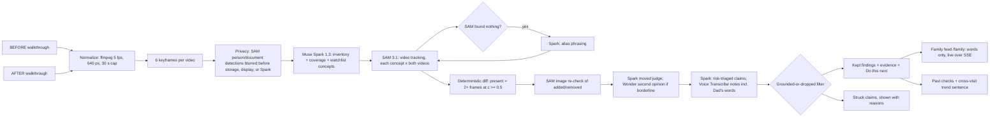

# Second Look — Know what changed in Dad's room, with proof

**Live demo:** https://harshitaggarwal01.github.io/splatdiff/ — static on GitHub Pages. *Try it now* replays a real recorded check; your own videos, voice notes, the family agent and the glasses view ask for **your own Meta API key**, kept in that browser tab only and sent only to api.meta.ai. The full server version runs with `python server.py`.

**Status:** submitted to the Meta Global AI Developer Hackathon (Indie track, Push the Frontier) on Nov 4, 2026 — built in one day. See *How this was built* and *How the demo video was made*.


Second Look compares two short phone walkthroughs of the same room — a BEFORE and an AFTER — and reports which objects were **added**, **removed**, or **moved**. Every kept finding is backed by SAM 3.1 detections (boxes, frame ids, confidences). Any claim the reasoning model makes that SAM evidence does not support is **dropped and shown as dropped**, struck through with the reason, in a section called "Struck from the report".

SplatDiff is the engine codename from the author's earlier 3D-scene research; this product uses no Gaussian splats.

The lead story: Dad is 82 and lives alone. After a hospital discharge or a near-miss, his daughter films the OT-approved safe setup as a baseline — walker next to the bed, lamp within reach, path to the bathroom clear. On her next visit she films again. Second Look shows her what changed in between: is the walker still within reach, has clutter appeared on the floor, was the lamp moved away from the bed?

**The grounded room-change check is the working product.** The glasses view described below is "Dad's point of view" — a working simulation, not a Meta product integration.

## Why

The CDC reports that about 1 in 4 adults aged 65+ falls each year, and home hazards are a modifiable risk factor. Families often visit periodically, and small changes between visits go unnoticed: a walker pushed out of reach, clutter building up on the floor. Those changes can create hazards. Second Look does not claim to reduce falls — it detects changes to the objects in a room, which is one factor among many (strength and balance, medications, vision and blood pressure all matter too, which is why an OT assessment remains the gold standard).

A false alarm wastes trust; a miss can matter far more. So Second Look follows one rule — **grounded or dropped**: a finding is kept only if SAM 3.1 evidence supports it, and everything else is shown struck, with the reason, rather than hidden. And because a missed "walker moved" is the catastrophic error here, we say plainly: **false negatives matter more than false positives.** Our grounding story is about killing false claims; it says nothing yet about recall in a real, cluttered room, which is barely tested — one real pair so far (see *Real footage*).

You do not need two walkthroughs on day one. Value starts at visit #2. Film today's safe room as the baseline; next visit, we show you what changed.

## The product, by route

Run `python server.py`, then:

| Route | What it is |
|---|---|
| `/` | Product page, with **Try it now**. |
| `/app` | The Care dossier app — the working room-change check described below. |
| `/family` | The family feed — words only, never pictures, live over SSE. |
| `/glasses` | "Dad's point of view" — a working **simulation** of a glasses-style view (see below). Not a Meta product integration. |

## The Care dossier app (`/app`)

One room at a time, built around how visits actually work:

- **Rooms, filmed by, saved baseline per room.** Each check names the room (Bedroom, Hallway, Kitchen…) and who filmed it. A room can keep a saved baseline; compare later visits against it instead of re-uploading the "before" clip. **"This is the new setup"** promotes a finished check's "after" state to become the room's new baseline when Dad's setup legitimately changes.
- **Record with this phone.** Film either walkthrough in the browser instead of uploading a file.
- **Watchlist, typed or spoken.** The things that must stay put — walker, lamp, medication basket — typed in, or spoken as a care note and transcribed with Muse Voice Transcribe (`muse-voice-transcribe-1.0`), including diarization, so who said what is preserved. That matters: when **Dad's own words** explain a change — *"I moved the lamp so I can read by my chair"* — the finding is marked as **his choice, with low risk**, instead of being flagged to the family as a problem. Dad narrating his own room is evidence, not just audio.
- **Privacy blur before anything is stored, shown or sent on.** People and paper documents detected in frames are blurred before any frame is stored, shown, or sent to Muse Spark for reasoning. On the sample pair, **2 documents were blurred**. (SAM 3.1 itself sees the raw frame because it is the detector doing the blurring.) Raw videos are **deleted by default** after the check; keeping them is opt-in. Any check can be deleted ("Delete a check").
- **Coverage check, with a retake tip.** Before trusting a diff, Second Look checks the two walkthroughs actually cover the same corners, and tells you what to re-film if they don't ("re-film the bathroom door"). On the sample pair the coverage score is **0.9**. A low-coverage diff is labelled as such rather than presented as fact.
- **Grounded floor-clutter check.** Objects claimed to be on the floor in a walking path must be proven by SAM detections low in the frame; unproven clutter claims are struck like everything else.
- **SAM vocabulary repair.** SAM does not always know a family's word. When a watchlist concept returns nothing, Muse Spark proposes a phrasing SAM can segment and SAM re-runs. Verified: **"walker" → "metal walking frame", found at c 0.875**.
- **Image re-check strike.** Added/removed claims get a second, image-level SAM check on frames from the side where the object supposedly wasn't. Verified: an "armchair added" claim was struck when the image re-check found the armchair in the BEFORE frames at **c 0.75** — video tracking had simply missed it.
- **Muse Wonder second opinions and trends.** Borderline "moved" calls get a Muse Wonder (`muse-wonder-1.0`) second opinion at runtime rather than a coin-flip threshold, and a cross-visit **trend sentence** summarises how a room is changing over successive checks.
- **Acting on a finding:** a **Needs-attention banner** when anything is high-risk; **Do this next** on every serious finding, **ask Dad first** before treating a change as a problem; **Mark as sorted** when it's handled; **Send to family**; **Print** a plain-language report.
- **Past checks** per room, and **`.ics` re-film reminders** (download a calendar file: "re-film Dad's bedroom") so the next visit actually happens.

## The family feed (`/family`)

For the family who weren't there:

- **Words only, never pictures.** No frames, no video, no transcripts — just findings in plain sentences, each traceable back to evidence in the app.
- **Live over SSE, within a minute** of a check finishing. An opt-in browser notification announces new entries (only if the family member turns it on).
- **Fall alerts can land here — from a better sensor.** A fall alert from *any* sensor — watch, pendant, radar, or glasses — can be posted to this same family feed after an **"Are you OK?" check-in**. Plainly: **glasses are a poor fall sensor** — they are off or charging at night and in the bathroom, exactly when serious falls cluster, and head motion is not body impact. Fall detection is partner territory; in the demo it is **simulated**, and Second Look does not claim to detect falls.
- **"Ask about Dad's room"** — an agent grounded in the words feed. It answers with citations to feed entries and careful language: something was **"seen where it was"** at a stated time, not guaranteed to be there now.
- **"Write an update for"** — one click drafts an update calibrated to the reader: **nearby** family (practical, who can pop in), **far away** family (reassuring, fuller context), or **Dad** — written *to* him, not about him.

## Dad's point of view: the glasses simulation (`/glasses`)

`/glasses` is a **working simulation** of what this product becomes from Dad's point of view — labelled as a simulation, running on this laptop with a phone-style camera view, **not** a Meta product integration and not running on Meta glasses.

What is real in the simulation:

- **Real SAM 3.1 calls per frame, ~0.9 s per frame.** The simulated glasses view runs the same detector as the room check — nothing is canned.
- **Whispered watchlist prompts in Dad's ear**, e.g. *"Walker — on your left, close."* Position and proximity from the frame, spoken quietly, hands-free.
- **"Where did I leave it?"** — a tab-only last-seen memory. Ask where the keys / glasses / walker were last seen and it answers only from what the camera actually saw, in honest language: *"Last seen 6:04 pm on the kitchen table — not seen since."* Never "your keys are…" as present truth. Last seen is not current location, and for medication it is never evidence of taking anything: check before taking.

**Roadmap, stated as roadmap:** live glasses streaming via **Meta's Wearables Device Access Toolkit** is the intended next capture surface. It is not built, not demoed as built, and judges should score it as a direction, not a feature.

## How Meta's models work together

**4 run it, 2 built it.**

Four Meta models run the product:

| Model | Role |
|---|---|
| `muse-spark-1.3` (reasons) | Room inventory from keyframes; coverage judging; vocabulary-repair aliases; pairwise moved judgement relative to surrounding furniture; risk-triaged report, next steps, and feed wording. |
| `sam-3.1` (proves) | Text-prompted video tracking of every object in both walkthroughs; image re-checks; privacy blurring detections; floor-clutter verification; per-frame detections in the glasses simulation. |
| `muse-voice-transcribe-1.0` (listens) | Spoken watchlists and care notes, with diarization — so Dad's own explanation marks a finding as his choice (low risk). |
| `muse-wonder-1.0` (second opinion) | Second opinions on borderline "moved" calls, and the cross-visit trend sentence. |

Two more built it:

| Model | Role |
|---|---|
| `muse-image-1.0` | Generated the synthetic test room and its edited "after" version used for the sample pair and ground truth. |
| `muse-wonder-1.0` | Wrote the codebase — **30 generation rounds from written specs, with up to 5 workers in parallel**, each reviewed and run by a human, **plus 6 red-team critiques** — 3 by Muse Wonder (idea and logic, a second pass, and the glasses pivot) and 3 by Muse Spark (caregiver personas twice, and a visual review of UI screenshots). Specs, transcripts and critiques are in `build_log/`. |

Verified model-needs-model moments: SAM returned nothing for "walker"; Spark's "metal walking frame" let SAM find it at c 0.875. SAM video tracking missed the armchair in BEFORE; its own image re-check found it at c 0.75 and struck Spark's "armchair added" claim.

## Architecture



The grounding filter: `added` kept only if SAM's label is `added`; `removed` only if `removed`; `moved` only if SAM says `present_both` **and** the moved verdict holds (with a Wonder second opinion on borderline calls). Unmentioned SAM-only added/removed changes are added back as kept claims with `source: "sam"`. Every Meta API call is logged to `cache/costs.jsonl`, and Responses calls are disk-cached in `cache/responses/` (`SPLATDIFF_NO_CACHE=1` disables), making replays free and instant.

Two rules were added after running real phone footage: when the two walkthroughs only partly overlap (coverage below 0.7), an added/removed claim for an object that is **not** on the watchlist is struck as *possibly out of view* (watchlist items are always kept — a false alarm beats a miss); and if the written summary repeats a struck claim, it is rebuilt from the proven findings only, so the headline never asserts an unproven change.

## Honest numbers

On our one scoreable test room (3+ runs), the raw model invented 25–40% of claims; grounding struck every one — **a smoke test, not a benchmark**. Real rooms: one pair so far (below). Recall on real cluttered rooms — the number that matters most, since a missed "walker moved" is the catastrophic error — is not yet measured. A fresh sample check takes **~1–1.5 min and ~$0.24–0.33**; cached replays are free and instant.


### Real footage (one pair, Nov 4 2026)

A computer lab filmed twice on an iPhone (HDR HEVC, ~18 s each). Between the walkthroughs, chairs were pulled out from under the desks into the aisle and writing was added to a whiteboard.

- **Kept:** *chair — moved* (high risk; moved-judge 0.92: "was tucked centered under desk facing monitor, now pulled out to left side").
- **Struck:** *trash bin — added* — "The two walkthroughs only partly overlap (60%), so the trash bin may simply have been out of view in the first video. Re-film that corner to confirm." The first video never showed that floor spot; this rule was added after this run exposed the gap.
- **Not reported:** the whiteboard writing — Second Look checks objects, not what is written on them; the board itself was *seen where it was*.
- Muse Wonder's second opinion fired on a borderline keyboard call (ruled not moved). No people in frame. First full run: 82 s, $0.44.

One real pair is a smoke test, not a benchmark. The raw videos are not published; the report's frames are, in the live demo under Past checks.

## Public demo: GitHub Pages and bring-your-own-key

The live demo is a static build of the same pages (`python scripts/build_static.py` with the server running writes `docs/`, published by GitHub Pages). With no server:

- **Try it now** replays a real recorded check (its actual event stream), and *Past checks* opens real results, including the real-footage lab check.
- **Your own videos, voice notes, the family agent and the glasses view** ask for your own Meta Model API key. It is kept in that browser tab only (sessionStorage) and sent only to `api.meta.ai`, which allows browser calls (CORS) — never to us. Your own two videos run through a keyframe-based browser version of the pipeline (`web/browser-pipeline.js`): blur, inventory, SAM checks with vocabulary repair, moved judge, report and the grounding filter.
- On your own server (`python server.py`) the key stays server-side in `.env`.

## How the demo video was made

`scripts/demo/record_demo.py` drives the local app in headless Microsoft Edge with Playwright and records 1920×1080 video in script order, logging each scene's timing. The narration was transcribed with **Muse Voice Transcribe**, whose phrase timestamps set the scene cuts; `scripts/demo/build_final.py` speeds up or holds each scene to fit the voice, burns in captions and adds the narration. No media files are in the repo.

## Setup

```bash
pip install -r requirements.txt
cp .env.example .env   # fill in MODEL_API_KEY
python server.py       # Care dossier UI at http://127.0.0.1:8000
```

Gradio fallback UI:

```bash
python app.py
```

Synthetic sample pair (Muse Image stills + Ken-Burns pan videos; generation is skipped if `data/before.jpg` / `data/after.jpg` already exist):

```bash
python scripts/make_synthetic.py
```

Static GitHub Pages build (server must be running):

```bash
python scripts/build_static.py
```

CLI:

```bash
python -m splatdiff.pipeline before.mp4 after.mp4
python -m splatdiff.pipeline before.mp4 after.mp4 --concepts "floor lamp,backpack,walker"
```

Eval (fuzzy concept match; precision/recall/F1 for raw vs grounded claims, hallucinated-claim rate, cost, latency → `outputs/eval.md`):

```bash
python eval.py --gt data/gt.json --result outputs/<run>/result.json
python eval.py --gt data/gt.json --run before.mp4 after.mp4
```

Outputs land in `outputs/<run_id>/`: `result.json`, `report.md`, and annotated frames `before_<concept>.jpg` / `after_<concept>.jpg` with coloured boxes and labels (green added, red removed, orange moved).

## Limitations

- Viewpoint differences between the two handheld clips make "moved" the weakest call; the judge compares position relative to surrounding furniture rather than pixels.
- SAM recall on small or partly hidden objects is imperfect; a missed detection can flip a label, which the image re-check only partly mitigates. False negatives matter more than false positives in this product, and recall on real cluttered rooms is not yet measured (one real pair).
- Presence is not safety: a detected object may be unreachable, blocked or not working, and object detection cannot see states or absences such as a loose rug edge or a spill. "Seen where it was" is a sighting, not a guarantee.
- The glasses view is a simulation on `/glasses`. Live streaming via Meta's Wearables Device Access Toolkit is roadmap only; no Meta glasses integration exists in this repo.
- Glasses are a poor fall sensor (off/charging at night and in the bathroom; head motion ≠ body impact). Fall alerts in the feed are simulated and are partner territory (watch, pendant, radar).
- Last-seen memory only knows what the camera saw; drawers, dark rooms, charging gaps and other people moving things break the chain. It never answers medication questions beyond last-seen location and time.
- Boxes, not masks: mask payload encoding is undocumented, so evidence is box-level, not pixel-level.
- The 30 s cap at 5 fps bounds cost and latency but can miss detail.
- English voice notes only tested.
- Not a medical device. Second Look reports room changes; it does not assess a person's health or replace a professional safety assessment. Consent is per visit: ask together, film together; nothing is recorded between visits.

## Prior work disclosure

The author's earlier research on object-change detection in 3D scenes motivated this idea; no code, data, or figures from it are used — everything in this repo was written during the hackathon (Nov 4, 2026).
