# SplatDiff — What changed in this room?

Upload two short phone videos of the same room (BEFORE and AFTER). SplatDiff returns a **grounded change report**: which objects were **ADDED, REMOVED, or MOVED** — where every claim is backed by SAM 3.1 detections (boxes, frame ids, confidences), and any claim the reasoning model makes that SAM evidence does not support is **DROPPED and shown as dropped**.

Framing: a caregiver safety check of an elderly parent's room ("the walker was moved out of reach"), or a rental move-out inspection.

## Architecture

```mermaid
flowchart LR
  A[BEFORE video] --> N[Normalize ffmpeg 5fps 640px 30s cap]
  B[AFTER video] --> N
  N --> K[6 keyframes each]
  K --> S1[Muse Spark 1.3 inventory]
  S1 --> C[Concepts max 12]
  C --> SAM[SAM 3.1 tracking per concept x video]
  N --> SAM
  SAM --> D[Deterministic diff: presence = 2+ frames at c>=0.5]
  D --> RC[SAM 3.1 image re-check: added/removed concepts re-segmented on keyframes of the supposedly-absent side]
  RC --> D2[Corrected SAM labels: re-check find at c>=0.5 overturns added/removed to present_both]
  D2 --> S2[Muse Spark 1.3 moved judgement present_both]
  S2 --> S3[Muse Spark 1.3 final claims]
  S3 --> G{Grounded-or-dropped filter}
  D2 --> G
  G --> R[result.json + report.md + annotated frames]
```



**Models used (exact IDs):** `muse-spark-1.3` (inventory, moved judgement, report), `sam-3.1` (concept-prompt video segmentation), `muse-image-1.0` (synthetic sample generation only). The codebase itself was generated with `muse-wonder-1.0` via `build_log/wonder_build.py`.

## The grounded-or-dropped rule

- `added` is kept only if SAM's label is `added` (present only in AFTER).
- `removed` is kept only if SAM's label is `removed` (present only in BEFORE).
- **SAM image re-check:** before an `added`/`removed` label is trusted, SAM 3.1 image segmentation re-checks the concept on the keyframes of the side where video tracking said it was absent. If it is found there at c>=0.5, the label is corrected to `present_both` (the original video-tracking label is preserved as `original_label`) and any `added`/`removed` claim for it is dropped — e.g. video tracking missed an armchair in BEFORE, but the image re-check found it in BEFORE keyframe 1 at c=0.75, so "armchair added" was dropped.
- `moved` is kept only if SAM says `present_both` **and** the pairwise Spark moved-verdict is true with confidence >= 0.80.
- Everything else is dropped with a reason, and shown struck-through in the UI/report.
- SAM-only added/removed changes Spark missed are added back as kept claims with `source: "sam"`.

## Results

Eval on the synthetic Muse-Image pair (ground truth: backpack removed, floor lamp moved, red suitcase added), scored with `eval.py` (fuzzy concept match):

| Claims | n claims | Precision | Recall | Hallucinated-claim rate |
|---|---|---|---|---|
| Raw Muse Spark 1.3 claims | 5 | 0.60 | 1.00 | 0.40 |
| Grounded kept claims (after filter) | 3 | 1.00 | 1.00 | 0.00 |

Dropped claims on this pair:

- `armchair added` — SAM image re-check found armchair in BEFORE keyframe 1, c=0.75; SAM video tracking had missed it.
- `throw blanket moved` — moved-judge confidence 0.75 < 0.80.

**Read this honestly:** this is n=1 synthetic pair, and the 0.80 moved threshold was set after looking at this pair, so this is a smoke test, not a benchmark. Real-footage results are pending.

## Setup

```bash
pip install -r requirements.txt
cp .env.example .env   # fill MODEL_API_KEY
```

## Usage

CLI:

```bash
python -m splatdiff.pipeline before.mp4 after.mp4
python -m splatdiff.pipeline before.mp4 after.mp4 --concepts "floor lamp,backpack,walker"
```

UI:

```bash
python app.py
```

Synthetic sample pair (Muse Image + Ken-Burns pans; skipped if `data/before.jpg`/`data/after.jpg` exist):

```bash
python scripts/make_synthetic.py
```

Eval (fuzzy concept match, precision/recall/F1 for raw vs grounded claims, hallucinated-claim rate, cost, latency → `outputs/eval.md`):

```bash
python eval.py --gt data/sample_gt.json --result outputs/<run_id>/result.json
python eval.py --gt data/sample_gt.json --run data/sample_before.mp4 data/sample_after.mp4
```

Outputs land in `outputs/<run_id>/`: `result.json`, `report.md`, annotated `before_<concept>.jpg` / `after_<concept>.jpg` (green = added, red = removed, orange = moved).

## Cost per run

Measured on the synthetic pair above (run 2, fresh/uncached, moved-judge calls in parallel): **56 s and $0.33** — 23 SAM 3.1 video requests × 50 billed frames ($0.23) + 18 SAM 3.1 image re-checks ($0.045) + 12 Muse Spark 1.3 calls ($0.056). A cached re-run took **25 s** (Responses calls are disk-cached in `cache/responses/`; set `SPLATDIFF_NO_CACHE=1` to disable). List prices behind this: Spark $1.25/M input, $4.25/M output tokens; SAM $0.20 per 1000 video frames (min 50/request), $2.50 per 1000 images. Every call is appended to `cache/costs.jsonl`.

## How this was built

The spec lives in `build_log/SPEC.md`; the code was generated by `muse-wonder-1.0` through `build_log/wonder_build.py` (initial generation 80 s, ~17k output tokens; repair rounds driven by real run failures, raw transcripts in `build_log/wonder_*.md`), with a human reviewing and running every round.

## Honest limitations

- Handheld viewpoint changes between clips make "moved" judgement hard; we judge relative to surrounding furniture, not pixels, but it is still the weakest link.
- SAM recall on small/occluded objects is imperfect — a missed detection can flip a label.
- We use boxes, not masks (mask payload encoding is undocumented), so evidence is coarser than pixel-level.
- 30 s cap and 640 px width keep cost/latency bounded but lose fine detail.

## Prior work disclosure

The author's earlier research on object-change detection in 3D scenes motivated this idea; no code, data, or figures from it are used — everything in this repo was written during the hackathon (Nov 4, 2026).
