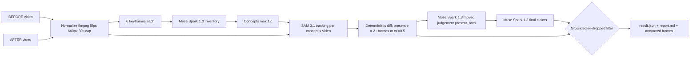

# SplatDiff — What changed in this room?

Upload two short phone videos of the same room (BEFORE and AFTER). SplatDiff returns a **grounded change report**: which objects were **ADDED, REMOVED, or MOVED** — where every claim is backed by SAM 3.1 detections (boxes, frame ids, confidences), and any claim the reasoning model makes that SAM evidence does not support is **DROPPED and shown as dropped**.

Framing: a caregiver safety check of an elderly parent's room ("the walker was moved out of reach"), or a rental move-out inspection.

## Architecture



**Models used (exact IDs):** `muse-spark-1.3` (inventory, moved judgement, report), `sam-3.1` (concept-prompt video segmentation), `muse-image-1.0` (synthetic sample generation only). The codebase itself was generated with `muse-wonder-1.0` via `build_log/wonder_build.py`.

## The grounded-or-dropped rule

- `added` is kept only if SAM's label is `added` (present only in AFTER).
- `removed` is kept only if SAM's label is `removed` (present only in BEFORE).
- `moved` is kept only if SAM says `present_both` **and** the pairwise Spark moved-verdict is true.
- Everything else is dropped with a reason, and shown struck-through in the UI/report.
- SAM-only added/removed changes Spark missed are added back as kept claims with `source: "sam"`.

## Setup

```bash
pip install -r requirements.txt
cp .env.example .env   # fill MODEL_API_KEY
```

## Usage

CLI:

```bash
python -m splatdiff.pipeline before.mp4 after.mp4
python -m splatdiff.pipeline before.mp4 after.mp4 --concepts "floor lamp,backpack,walker"
```

UI:

```bash
python app.py
```

Synthetic sample pair (Muse Image + Ken-Burns pans; skipped if `data/before.jpg`/`data/after.jpg` exist):

```bash
python scripts/make_synthetic.py
```

Eval (fuzzy concept match, precision/recall/F1 for raw vs grounded claims, hallucinated-claim rate, cost, latency → `outputs/eval.md`):

```bash
python eval.py --gt data/sample_gt.json --result outputs/<run_id>/result.json
python eval.py --gt data/sample_gt.json --run data/sample_before.mp4 data/sample_after.mp4
```

Outputs land in `outputs/<run_id>/`: `result.json`, `report.md`, annotated `before_<concept>.jpg` / `after_<concept>.jpg` (green = added, red = removed, orange = moved).

## Cost per run

Spark: $1.25/M input, $4.25/M output tokens. SAM: $0.20 per 1000 video frames (min 50/request) — a 30 s clip at 5 fps is 150 frames, so ~$0.03 per concept-video. With ≤12 concepts × 2 videos plus 2–4 Spark calls, a typical run is roughly **$0.50–$1.00**, and every call is appended to `cache/costs.jsonl`. All Responses calls are disk-cached in `cache/responses/` (set `SPLATDIFF_NO_CACHE=1` to disable), so demo re-runs are free and instant.

## Honest limitations

- Handheld viewpoint changes between clips make "moved" judgement hard; we judge relative to surrounding furniture, not pixels, but it is still the weakest link.
- SAM recall on small/occluded objects is imperfect — a missed detection can flip a label.
- We use boxes, not masks (mask payload encoding is undocumented), so evidence is coarser than pixel-level.
- 30 s cap and 640 px width keep cost/latency bounded but lose fine detail.

## Prior work disclosure

The author's earlier research on object-change detection in 3D scenes motivated this idea; no code, data, or figures from it are used — everything in this repo was written during the hackathon (Nov 4, 2026).
