=== FILE: splatdiff/diff.py ===
"""Pure deterministic diff + grounding filter. No API calls."""
from __future__ import annotations

PRESENCE_MIN_FRAMES = 2
CONF_THRESHOLD = 0.5
MOVED_MIN_CONF = 0.8

def summarize_track(parsed: dict) -> dict:
    """Summarise one concept in one video.

    ``best_frame``/``best_box`` are chosen by a demo-friendly score rather
    than raw confidence alone: detections cut off at the frame border are
    penalised (centrality 0.5 vs 1.0 for boxes at least 2 px inside every
    edge), with a small bonus for larger boxes:

        score = c * centrality * (0.75 + 0.25 * min(1, area_frac * 8))

    ``best_conf`` remains the raw confidence of the chosen detection, and
    ``mean_conf``/``frames_detected``/``max_instances`` are unchanged.
    """
    frames, confs, best_frame, best_box, best_c, best_score, max_inst = 0, [], None, None, -1.0, -1.0, 0
    for frame_idx in sorted((parsed or {}).keys(), key=lambda x: int(x)):
        dets = [d for d in parsed[frame_idx] if float(d.get("c", 0)) >= CONF_THRESHOLD]
        if not dets:
            continue
        frames += 1; max_inst = max(max_inst, len(dets))
        for d in dets:
            c = float(d.get("c", 0)); confs.append(c)
            box = list(d.get("box") or [])
            # Centrality / area need a valid box and frame size; be defensive.
            centrality, area_frac = 1.0, 0.0
            try:
                w, h = float(d.get("w", 0) or 0), float(d.get("h", 0) or 0)
                if len(box) == 4 and w > 0 and h > 0:
                    x1, y1, x2, y2 = (float(v) for v in box)
                    touches = x1 < 2 or y1 < 2 or x2 > w - 2 or y2 > h - 2
                    centrality = 0.5 if touches else 1.0
                    area_frac = max(0.0, (x2 - x1) * (y2 - y1)) / (w * h)
            except Exception:
                centrality, area_frac = 1.0, 0.0
            score = c * centrality * (0.75 + 0.25 * min(1.0, area_frac * 8))
            if score > best_score:
                best_score, best_c, best_frame, best_box = score, c, int(frame_idx), list(d.get("box"))
    return {"frames_detected": frames, "max_instances": max_inst,
            "mean_conf": (sum(confs) / len(confs)) if confs else 0.0,
            "best_frame": best_frame, "best_box": best_box,
            "best_conf": best_c if best_c >= 0 else 0.0, "present": frames >= PRESENCE_MIN_FRAMES}

def summarize_tracks(before_tracks: dict, after_tracks: dict) -> dict:
    """Per-concept summaries + SAM label for both videos."""
    out = {}
    for concept in sorted(set(before_tracks) | set(after_tracks)):
        b = summarize_track(before_tracks.get(concept, {}))
        a = summarize_track(after_tracks.get(concept, {}))
        if a["present"] and not b["present"]:
            label = "added"
        elif b["present"] and not a["present"]:
            label = "removed"
        elif b["present"] and a["present"]:
            label = "present_both"
        else:
            label = "not_found"
        out[concept] = {"concept": concept, "before": b, "after": a, "label": label,
                        "original_label": label, "recheck": None,
                        "count_changed": b["max_instances"] != a["max_instances"]}
    return out

def apply_image_recheck(summaries: dict, concept: str, recheck: dict | None) -> dict:
    """Record a SAM image re-check result in ``summaries`` (in place).

    ``recheck`` should contain at least ``video`` (``"before"``/``"after"``,
    the side where the object was supposedly absent), ``keyframe_index``,
    ``box`` and ``c`` when a detection was found. If any detection with
    c >= CONF_THRESHOLD was found, a video-tracking label of ``added`` /
    ``removed`` is corrected to ``present_both``. The original
    video-tracking label is preserved as ``original_label`` so callers can
    still show Spark (and the grounding filter) what video tracking said.
    Returns the updated summary (or {} if the concept is unknown).
    """
    s = summaries.get(concept)
    if s is None:
        return {}
    if "original_label" not in s or not s.get("original_label"):
        s["original_label"] = s.get("label")
    if recheck is None:
        s["recheck"] = {"checked": False, "found": False, "video": None,
                        "keyframe_index": None, "box": None, "c": 0.0}
        return s
    info = dict(recheck)
    info.setdefault("checked", True)
    # Normalise / derive the "found" flag from the confidence.
    try:
        c_val = float(info.get("c", 0.0) or 0.0)
    except Exception:
        c_val = 0.0
    info["c"] = c_val
    if info.get("box") is not None:
        try:
            info["box"] = list(info["box"])
        except Exception:
            pass
    if info.get("keyframe_index") is not None:
        try:
            info["keyframe_index"] = int(info["keyframe_index"])
        except Exception:
            pass
    info["found"] = bool(info.get("found", c_val >= CONF_THRESHOLD and info.get("box") is not None))
    s["recheck"] = info
    if info["found"] and c_val >= CONF_THRESHOLD and s.get("label") in ("added", "removed"):
        s["label"] = "present_both"
    return s

def sam_labels(summaries: dict) -> dict:
    return {c: s.get("label", "not_found") for c, s in summaries.items()}

def _norm(s: str) -> str:
    return " ".join(str(s).lower().strip().split())

def _find(concept: str, summaries: dict):
    n = _norm(concept)
    if n in summaries:
        return n, summaries[n]
    best_key, best_v, best_overlap = None, None, 0
    for k, v in summaries.items():
        overlap = len(set(_norm(k).split()) & set(n.split()))
        if overlap > best_overlap:
            best_key, best_v, best_overlap = k, v, overlap
    if best_key is not None:
        return best_key, best_v
    return None, None

def _evidence(concept: str, s: dict) -> dict:
    return {"concept": concept, "label": s.get("label"),
            "original_label": s.get("original_label", s.get("label")),
            "recheck": s.get("recheck"),
            "frames_before": s["before"]["frames_detected"], "frames_after": s["after"]["frames_detected"],
            "best_box_before": s["before"]["best_box"], "best_box_after": s["after"]["best_box"],
            "best_frame_before": s["before"]["best_frame"], "best_frame_after": s["after"]["best_frame"],
            "confidence_before": s["before"]["best_conf"], "confidence_after": s["after"]["best_conf"],
            "mean_conf_before": s["before"]["mean_conf"], "mean_conf_after": s["after"]["mean_conf"],
            "max_instances_before": s["before"]["max_instances"], "max_instances_after": s["after"]["max_instances"]}

def _recheck_reason(key: str, s: dict, change: str) -> str | None:
    """Specific human-readable reason when a re-check overturns a claim."""
    r = s.get("recheck") or {}
    if not r.get("found"):
        return None
    try:
        c_val = float(r.get("c", 0.0) or 0.0)
    except Exception:
        c_val = 0.0
    video = str(r.get("video", "")).lower()
    side = "BEFORE" if video == "before" else "AFTER" if video == "after" else video.upper()
    idx = r.get("keyframe_index")
    if change == "added" and video == "before":
        return (f"SAM image re-check found '{key}' in BEFORE keyframe {idx} "
                f"(c={c_val:.2f}) - not added")
    if change == "removed" and video == "after":
        return (f"SAM image re-check found '{key}' in AFTER keyframe {idx} "
                f"(c={c_val:.2f}) - not removed")
    return None

def grounding_filter(raw_claims: list, summaries: dict, moved_verdicts: dict | None = None) -> tuple[list, list]:
    """Keep only claims SAM supports; add SAM-only added/removed claims.

    'moved' requires present_both AND a moved verdict with
    confidence >= MOVED_MIN_CONF.
    """
    moved_verdicts = moved_verdicts or {}
    kept, dropped, kept_concepts = [], [], set()
    for claim in raw_claims or []:
        concept_raw, change = str(claim.get("concept", "")), claim.get("change")
        key, s = _find(concept_raw, summaries)
        if s is None:
            dropped.append({**claim, "reason": f"no SAM evidence: concept '{concept_raw}' was not tracked"}); continue
        label = s["label"]
        ok, reason = False, ""
        if change == "added":
            ok = label == "added"
            reason = _recheck_reason(key, s, "added") or (
                f"SAM label is '{label}', not 'added' for '{key}'")
        elif change == "removed":
            ok = label == "removed"
            reason = _recheck_reason(key, s, "removed") or (
                f"SAM label is '{label}', not 'removed' for '{key}'")
        elif change == "moved":
            v = moved_verdicts.get(key) or moved_verdicts.get(concept_raw) or {}
            try:
                v_conf = float(v.get("confidence", 0.0) or 0.0)
            except Exception:
                v_conf = 0.0
            v_moved = bool(v.get("moved"))
            if label != "present_both":
                rc = _recheck_reason(key, s, "moved")
                reason = rc or f"SAM label is '{label}', not 'present_both' for '{key}' - not moved"
            elif not v_moved:
                detail = f": {v.get('reason')}" if v.get("reason") else ""
                reason = (f"moved-judge said not moved for '{key}' "
                          f"(confidence {v_conf:.2f}){detail}")
            elif v_conf < MOVED_MIN_CONF:
                reason = f"moved-judge confidence {v_conf:.2f} < {MOVED_MIN_CONF:.2f}"
            else:
                ok = True
        else:
            reason = f"unsupported change type '{change}'"
        if ok:
            kept.append({"concept": key, "change": change, "explanation": claim.get("explanation", ""),
                         "safety_note": claim.get("safety_note"), "source": "spark", "evidence": _evidence(key, s)})
            kept_concepts.add(key)
        else:
            dropped.append({**claim, "concept": key, "reason": reason})
    # SAM-only added/removed that Spark missed
    for concept, s in summaries.items():
        if s["label"] in ("added", "removed") and concept not in kept_concepts:
            kept.append({"concept": concept, "change": s["label"],
                         "explanation": f"SAM 3.1 detected '{concept}' as {s['label']} (present in "
                                        f"{s['after']['frames_detected'] if s['label']=='added' else s['before']['frames_detected']} frames).",
                         "safety_note": None, "source": "sam", "evidence": _evidence(concept, s)})
            kept_concepts.add(concept)
    return kept, dropped
=== END FILE ===
=== FILE: app.py ===
"""SplatDiff Gradio 6 UI."""
from __future__ import annotations
from pathlib import Path
import gradio as gr
from splatdiff.pipeline import run, build_report

def _fmt_report(result: dict) -> str:
    md = build_report(result)
    md += "\n\n### Dropped (struck through above) — grounded-or-dropped rule\nEvery kept claim is backed by SAM 3.1 boxes/frames/confidences in the JSON below."
    return md

def _gallery(result: dict) -> list:
    """Annotated images only for claimed concepts: kept first, then dropped.

    Files are named ``before_<concept_with_underscores>.jpg`` /
    ``after_<concept_with_underscores>.jpg`` in ``result['annotated_images']``.
    """
    annotated = [str(p) for p in (result.get("annotated_images", []) or [])]
    gallery, seen = [], set()

    def files_for(concept: str) -> list:
        slug = str(concept).strip().lower().replace(" ", "_")
        wanted = {f"before_{slug}.jpg", f"after_{slug}.jpg"}
        return [p for p in annotated if Path(p).name.lower() in wanted]

    for claim in result.get("kept_claims", []) or []:
        concept = str(claim.get("concept", "")).strip()
        if not concept:
            continue
        change = str(claim.get("change", "")).strip()
        caption = f"{concept} - {change.upper()} (kept)" if change else f"{concept} (kept)"
        for p in files_for(concept):
            if p not in seen:
                seen.add(p); gallery.append((p, caption))
    for claim in result.get("dropped", []) or []:
        concept = str(claim.get("concept", "")).strip()
        if not concept:
            continue
        change = str(claim.get("change", "")).strip()
        reason = str(claim.get("reason", "")).strip()
        caption = f"{concept} - {change} (DROPPED: {reason})" if reason else f"{concept} - {change} (DROPPED)"
        for p in files_for(concept):
            if p not in seen:
                seen.add(p); gallery.append((p, caption))
    return gallery

def run_ui(before, after, concepts_text, progress=gr.Progress()):
    if not before or not after:
        return "Please provide both videos.", [], {}, "No run yet."
    def prog(msg):
        progress(0.5, desc=msg)
    concepts = [c.strip() for c in concepts_text.split(",") if c.strip()] if concepts_text and concepts_text.strip() else None
    result = run(before, after, concepts=concepts, progress=prog)
    gallery = _gallery(result)
    line = f"Cost (this run, ledger delta): ${result.get('cost_usd',0):.4f} · Latency: {result.get('latency_s',0):.1f}s · Run: {result.get('run_id','')}"
    return _fmt_report(result), gallery, result, line

def load_sample():
    b, a = "data/sample_before.mp4", "data/sample_after.mp4"
    if Path(b).exists() and Path(a).exists():
        return b, a, "Sample pair loaded."
    return None, None, "Sample pair not found — run: python scripts/make_synthetic.py"

with gr.Blocks(title="SplatDiff") as demo:
    gr.Markdown("# SplatDiff — What changed in this room?\nGrounded-or-dropped change reports from SAM 3.1 + Muse Spark 1.3.")
    with gr.Row():
        before_in = gr.Video(label="BEFORE video")
        after_in = gr.Video(label="AFTER video")
    concepts_in = gr.Textbox(label="Concepts override (optional, comma-separated)", placeholder="floor lamp, backpack, red suitcase")
    with gr.Row():
        run_btn = gr.Button("Run SplatDiff", variant="primary")
        sample_btn = gr.Button("Load sample pair")
    status = gr.Textbox(label="Status / cost & latency", interactive=False)
    report_out = gr.Markdown(label="Report")
    gallery_out = gr.Gallery(label="Annotated keyframes", columns=3)
    json_out = gr.JSON(label="Raw result")
    gr.Markdown("Grounded-or-dropped: every kept claim has SAM 3.1 evidence; Spark claims without it are struck through.")
    sample_btn.click(load_sample, outputs=[before_in, after_in, status])
    run_btn.click(run_ui, inputs=[before_in, after_in, concepts_in], outputs=[report_out, gallery_out, json_out, status])

if __name__ == "__main__":
    demo.launch()
=== END FILE ===
=== FILE: README.md ===
# SplatDiff — What changed in this room?

Upload two short phone videos of the same room (BEFORE and AFTER). SplatDiff returns a **grounded change report**: which objects were **ADDED, REMOVED, or MOVED** — where every claim is backed by SAM 3.1 detections (boxes, frame ids, confidences), and any claim the reasoning model makes that SAM evidence does not support is **DROPPED and shown as dropped**.

Framing: a caregiver safety check of an elderly parent's room ("the walker was moved out of reach"), or a rental move-out inspection.

## Architecture

```mermaid
flowchart LR
  A[BEFORE video] --> N[Normalize ffmpeg 5fps 640px 30s cap]
  B[AFTER video] --> N
  N --> K[6 keyframes each]
  K --> S1[Muse Spark 1.3 inventory]
  S1 --> C[Concepts max 12]
  C --> SAM[SAM 3.1 tracking per concept x video]
  N --> SAM
  SAM --> D[Deterministic diff: presence = 2+ frames at c>=0.5]
  D --> RC[SAM 3.1 image re-check: added/removed concepts re-segmented on keyframes of the supposedly-absent side]
  RC --> D2[Corrected SAM labels: re-check find at c>=0.5 overturns added/removed to present_both]
  D2 --> S2[Muse Spark 1.3 moved judgement present_both]
  S2 --> S3[Muse Spark 1.3 final claims]
  S3 --> G{Grounded-or-dropped filter}
  D2 --> G
  G --> R[result.json + report.md + annotated frames]
```



**Models used (exact IDs):** `muse-spark-1.3` (inventory, moved judgement, report), `sam-3.1` (concept-prompt video segmentation), `muse-image-1.0` (synthetic sample generation only). The codebase itself was generated with `muse-wonder-1.0` via `build_log/wonder_build.py`.

## The grounded-or-dropped rule

- `added` is kept only if SAM's label is `added` (present only in AFTER).
- `removed` is kept only if SAM's label is `removed` (present only in BEFORE).
- **SAM image re-check:** before an `added`/`removed` label is trusted, SAM 3.1 image segmentation re-checks the concept on the keyframes of the side where video tracking said it was absent. If it is found there at c>=0.5, the label is corrected to `present_both` (the original video-tracking label is preserved as `original_label`) and any `added`/`removed` claim for it is dropped — e.g. video tracking missed an armchair in BEFORE, but the image re-check found it in BEFORE keyframe 1 at c=0.75, so "armchair added" was dropped.
- `moved` is kept only if SAM says `present_both` **and** the pairwise Spark moved-verdict is true with confidence >= 0.80.
- Everything else is dropped with a reason, and shown struck-through in the UI/report.
- SAM-only added/removed changes Spark missed are added back as kept claims with `source: "sam"`.

## Results

Eval on the synthetic Muse-Image pair (ground truth: backpack removed, floor lamp moved, red suitcase added), scored with `eval.py` (fuzzy concept match):

| Claims | n claims | Precision | Recall | Hallucinated-claim rate |
|---|---|---|---|---|
| Raw Muse Spark 1.3 claims | 5 | 0.60 | 1.00 | 0.40 |
| Grounded kept claims (after filter) | 3 | 1.00 | 1.00 | 0.00 |

Dropped claims on this pair:

- `armchair added` — SAM image re-check found armchair in BEFORE keyframe 1, c=0.75; SAM video tracking had missed it.
- `throw blanket moved` — moved-judge confidence 0.75 < 0.80.

**Read this honestly:** this is n=1 synthetic pair, and the 0.80 moved threshold was set after looking at this pair, so this is a smoke test, not a benchmark. Real-footage results are pending.

## Setup

```bash
pip install -r requirements.txt
cp .env.example .env   # fill MODEL_API_KEY
```

## Usage

CLI:

```bash
python -m splatdiff.pipeline before.mp4 after.mp4
python -m splatdiff.pipeline before.mp4 after.mp4 --concepts "floor lamp,backpack,walker"
```

UI:

```bash
python app.py
```

Synthetic sample pair (Muse Image + Ken-Burns pans; skipped if `data/before.jpg`/`data/after.jpg` exist):

```bash
python scripts/make_synthetic.py
```

Eval (fuzzy concept match, precision/recall/F1 for raw vs grounded claims, hallucinated-claim rate, cost, latency → `outputs/eval.md`):

```bash
python eval.py --gt data/sample_gt.json --result outputs/<run_id>/result.json
python eval.py --gt data/sample_gt.json --run data/sample_before.mp4 data/sample_after.mp4
```

Outputs land in `outputs/<run_id>/`: `result.json`, `report.md`, annotated `before_<concept>.jpg` / `after_<concept>.jpg` (green = added, red = removed, orange = moved).

## Cost per run

Measured on the synthetic pair above: a fresh (uncached) run took **~110 s and ~$0.30** — 24 SAM 3.1 video requests × 50 billed frames (the per-request minimum) + ~11 Muse Spark 1.3 calls + 6–18 SAM 3.1 image re-checks. A cached re-run took **25 s** (Responses calls are disk-cached in `cache/responses/`; set `SPLATDIFF_NO_CACHE=1` to disable). List prices behind this: Spark $1.25/M input, $4.25/M output tokens; SAM $0.20 per 1000 video frames (min 50/request), $2.50 per 1000 images. Every call is appended to `cache/costs.jsonl`.

## How this was built

The spec lives in `build_log/SPEC.md`; the code was generated by `muse-wonder-1.0` through `build_log/wonder_build.py` (initial generation 80 s, ~17k output tokens; repair rounds driven by real run failures, raw transcripts in `build_log/wonder_*.md`), with a human reviewing and running every round.

## Honest limitations

- Handheld viewpoint changes between clips make "moved" judgement hard; we judge relative to surrounding furniture, not pixels, but it is still the weakest link.
- SAM recall on small/occluded objects is imperfect — a missed detection can flip a label.
- We use boxes, not masks (mask payload encoding is undocumented), so evidence is coarser than pixel-level.
- 30 s cap and 640 px width keep cost/latency bounded but lose fine detail.

## Prior work disclosure

The author's earlier research on object-change detection in 3D scenes motivated this idea; no code, data, or figures from it are used — everything in this repo was written during the hackathon (Nov 4, 2026).
=== END FILE ===