=== FILE: README.md ===
# SplatDiff — What changed in this room?

SplatDiff compares two short phone walkthroughs of the same room — a BEFORE and an AFTER — and reports which objects were **added**, **removed**, or **moved**. Every kept finding is backed by SAM 3.1 detections (boxes, frame ids, confidences). Any claim the reasoning model makes that SAM evidence does not support is **dropped and shown as dropped**, struck through with the reason, in a section called "Struck from the report".

The main use case is a family caregiver checking an elderly parent's room between visits: is the walker still within reach, has clutter appeared on the floor, was the lamp moved away from the bed? The same engine also fits rental move-out inspections.

## Why

The CDC reports that about 1 in 4 adults aged 65+ falls each year, and home hazards are a modifiable risk factor. Families often visit periodically, and slow drift between visits goes unnoticed: a walker pushed out of reach, clutter building up on the floor. A false alarm wastes trust; a miss can mean a fall. So SplatDiff follows one rule — **grounded or dropped**: a finding is kept only if SAM 3.1 evidence supports it, and everything else is shown struck, with the reason, rather than hidden.

## Demo flow

1. Open the Care dossier UI at `http://127.0.0.1:8000` (run `python server.py`).
2. Load the sample pair (`data/sample_before.mp4` / `data/sample_after.mp4`, a synthetic living room generated with Muse Image) or upload two phone walkthroughs.
3. Add a care watchlist — items that *must stay put*, typed, or spoken as a care note (transcribed with Muse Voice Transcribe; a 10-second note transcribes in about 2.3 s). Watchlist items are always tracked, even if the room inventory misses them.
4. Click run and watch the live "check as it happens" view: each pipeline stage streams over SSE with a running cost — normalising, keyframes, inventory, tracking, vocabulary repair if needed, image re-checks, moved judging, reporting, filtering.
5. Read the report: watchlist first with a status each (`in_place` / `moved` / `missing` / `appeared` / `not_seen`) and a risk level; then other findings, an evidence board, and the "Struck from the report" section. Print it as a family print report or copy a plain-text summary. Past checks replay from the run history — cached runs are free and instant.

## Features

- **Care watchlist** ("must stay put"): typed or spoken; always tracked; reported first, each item with a status (`in_place` / `moved` / `missing` / `appeared` / `not_seen`) and a risk level.
- **Risk triage**: every finding is rated high / medium / low through a fall-risk lens (a walker out of reach is not the same as a moved cushion).
- **Live check view**: every stage streams over SSE with filmstrips, per-concept chips and a running cost, so you can watch the check as it happens.
- **Evidence board**: before/after frames with SAM boxes drawn, frames seen, confidences, and the image re-check result for anything that appeared or vanished.
- **"Struck from the report"**: claims without SAM support are shown struck through (with an ink-strike animation in the UI) with a specific reason each — not silently deleted.
- **Vocabulary repair**: if SAM returns nothing for a concept, Muse Spark proposes alias phrasings and SAM tests them (details below).
- **SAM image re-check**: anything reported added or removed is re-checked by SAM image segmentation on frames from the side where it supposedly was not present (details below).
- **Family print report + copy summary**: a calm, printable report and a copyable plain-text summary to send to family.
- **Past checks replay**: previous runs are listed from `outputs/` and replay from cache — cached runs are free and instant.
- **Two interfaces**: the Care dossier UI (`web/`, served by `server.py` at `http://127.0.0.1:8000`) and a Gradio fallback (`app.py`).

## Architecture

```mermaid
flowchart LR
  A[BEFORE walkthrough] --> N[Normalize: ffmpeg 5 fps, 640 px, 30 s cap]
  B[AFTER walkthrough] --> N
  VN[Spoken care note recorded while filming] --> VT[Muse Voice Transcribe 1.0 transcription]
  VT --> W[Care watchlist: items that must stay put]
  W -.-> S1
  N --> K[6 keyframes per video]
  K --> S1[Muse Spark 1.3: room inventory + watchlist concepts]
  S1 --> C[Concept list]
  C --> SAM[SAM 3.1: text-prompted video tracking, each concept x both videos]
  N --> SAM
  SAM --> VR{SAM found nothing?}
  VR -->|yes| AL[Muse Spark 1.3: propose alias phrasings]
  AL --> SAM2[SAM 3.1: test aliases on the video]
  SAM2 --> D
  VR -->|no| D[Deterministic diff: present = 2+ frames at c >= 0.5]
  D --> RC[SAM 3.1 image re-check: added/removed concepts re-segmented on frames of the supposedly-absent side]
  RC --> D2[Corrected SAM labels: a re-check find overturns added/removed]
  D2 --> S2[Muse Spark 1.3: pairwise moved judgement, present_both concepts]
  S2 --> S3[Muse Spark 1.3: risk-triaged report + spoken notes to watchlist items]
  S3 --> G{Grounded-or-dropped filter}
  D2 --> G
  G --> R[Kept findings + evidence board]
  G --> X[Struck claims, shown with reasons]
  R --> OUT[result.json + report.md + annotated frames + live SSE cost]
```



Pipeline detail: videos are normalised with the ffmpeg binary from `imageio-ffmpeg` to H.264 MP4 at 5 fps, 640 px wide, capped at 30 s (at most 150 frames per clip), cached by input SHA-256. Muse Spark reads 6 keyframes from each video and returns a strict-JSON inventory of movable household objects (max 12), plus the care watchlist concepts. SAM 3.1 then tracks every concept in both videos (requests run concurrently). Presence is deterministic: detected in at least 2 frames at confidence at least 0.5. For concepts present in both videos, Spark judges "moved" from the best before/after frames with the SAM box drawn, judging position relative to surrounding furniture because the camera viewpoint differs between videos; a moved claim is kept only at judge confidence at least 0.80. The final report call receives the full diff table and writes claims, each with a risk level and reason. The grounding filter then keeps or strikes each claim:

- `added` kept only if SAM's label is `added`; `removed` only if `removed`.
- `moved` kept only if SAM says `present_both` **and** the pairwise moved verdict is true at confidence >= 0.80.
- Everything else is dropped with a reason string, and SAM-only added/removed changes that Spark failed to mention are added back as kept claims with `source: "sam"`.

Every Meta API call is logged to `cache/costs.jsonl` (model, kind, estimated USD, latency, timestamp), and Responses calls are disk-cached in `cache/responses/` keyed by request hash (`SPLATDIFF_NO_CACHE=1` disables this), which is what makes replays free and instant.

## How Meta's models work together

| Model | Role in SplatDiff |
|---|---|
| `muse-spark-1.3` | Room inventory from keyframes; vocabulary-repair aliases when SAM does not know a word; pairwise moved judge; risk-triaged report; turning spoken notes into watchlist items. |
| `sam-3.1` | Text-prompted video tracking of every object in both walkthroughs; image re-check of anything that appeared or vanished; testing alias phrasings during vocabulary repair. |
| `muse-voice-transcribe-1.0` | Transcribes spoken care notes and the optional narration recorded while filming (10 s note in ~2.3 s). |
| `muse-image-1.0` | Generated the synthetic test room and its edited "after" version used for the sample pair and ground truth. |
| `muse-wonder-1.0` | Generated the codebase: ~11 generation rounds from written specs in `build_log/`, with up to 2–4 workers in parallel (pipeline, server, front-end, voice), each round reviewed and run by a human; transcripts in `build_log/wonder_*.md`. |

Two verified moments show why the models need each other:

- **Vocabulary repair (verified):** SAM returned nothing for "walker". Spark proposed "metal walking frame"; SAM then found it at c=0.875, and the walker was correctly reported "still in place".
- **SAM image re-check (verified):** video tracking missed the armchair in the before clip. The image re-check found it at c=0.75, and the false "armchair added" claim was struck from the report.

## Results

Results on the synthetic pair (ground truth: backpack removed, floor lamp moved, red suitcase added), scored with `eval.py` (fuzzy concept match), across 3 runs:

| Claims | Precision | Recall | Hallucinated-claim rate |
|---|---|---|---|
| Raw Muse Spark 1.3 claims | 0.60–0.75 | 1.00 | 25–40% |
| Grounded kept claims (after the filter) | 1.00 | 1.00 | 0% |

Honest caveats: this is n=1 synthetic pair; the 0.80 moved threshold was set after looking at it; this is a smoke test, not a benchmark; real footage is pending.

## Cost

A fresh, uncached run on the sample pair takes about 1 minute and about **$0.33**: SAM video tracking ~$0.23 (26 SAM requests / ~650 frames per run on the sample), SAM image re-checks ~$0.05, Muse Spark ~$0.06. Cached replays are free and instant. Every call is itemised in `cache/costs.jsonl`.

## Setup

```bash
pip install -r requirements.txt
cp .env.example .env   # fill in MODEL_API_KEY
python server.py       # Care dossier UI at http://127.0.0.1:8000
```

Gradio fallback UI:

```bash
python app.py
```

Synthetic sample pair (Muse Image stills + Ken-Burns pan videos; generation is skipped if `data/before.jpg` / `data/after.jpg` already exist):

```bash
python scripts/make_synthetic.py
```

CLI:

```bash
python -m splatdiff.pipeline before.mp4 after.mp4
python -m splatdiff.pipeline before.mp4 after.mp4 --concepts "floor lamp,backpack,walker"
```

Eval (fuzzy concept match; precision/recall/F1 for raw vs grounded claims, hallucinated-claim rate, cost, latency → `outputs/eval.md`):

```bash
python eval.py --gt data/gt.json --result outputs/<run>/result.json
python eval.py --gt data/gt.json --run before.mp4 after.mp4
```

Outputs land in `outputs/<run_id>/`: `result.json`, `report.md`, and annotated frames `before_<concept>.jpg` / `after_<concept>.jpg` with coloured boxes and labels (green added, red removed, orange moved).

## How this was built (Muse Wonder)

This codebase was generated with `muse-wonder-1.0` over ~11 generation rounds from written specs kept in `build_log/`, with up to 2–4 workers running in parallel — pipeline, server, front-end, and voice workers — each round reviewed and run by a human before the next. The raw transcripts are in `build_log/wonder_*.md`; the specs they were generated from are in `build_log/` alongside them.

## Limitations

- Viewpoint differences between the two handheld clips make "moved" the weakest call; the judge compares position relative to surrounding furniture rather than pixels, but it is still the least reliable label.
- SAM recall on small or partly hidden objects is imperfect; a missed detection can flip a label, which the image re-check only partly mitigates.
- Boxes, not masks: mask payload encoding is undocumented, so evidence is box-level, not pixel-level.
- The 30 s cap at 5 fps bounds cost and latency but can miss detail.
- English voice notes only tested.
- Not a medical device. SplatDiff reports room changes; it does not assess a person's health or replace a professional safety assessment.

## Prior work disclosure

The author's earlier research on object-change detection in 3D scenes motivated this idea; no code, data, or figures from it are used — everything in this repo was written during the hackathon (Nov 4, 2026).
=== END FILE ===
=== FILE: VIDEO_SCRIPT.md ===
# SplatDiff — 3-minute demo script (v2)

Total running time: 3:00 maximum. Narrate plainly; let the screen carry the detail.

**0:00–0:15 — The hook.** "Last month this room was fine. This month, the walker has been pushed out of reach — and nobody noticed. About 1 in 4 adults over 65 falls each year, and small changes at home are part of that risk. SplatDiff checks what changed in a room, from two short phone videos, and shows its evidence for every finding."

**0:15–0:35 — The room and the ground truth.** Show the sample pair side by side (`data/sample_before.mp4`, `data/sample_after.mp4`). "Same synthetic living room, filmed twice. Three things changed: the blue backpack was removed, the floor lamp moved next to the armchair, and a red suitcase appeared. Keep those three in mind — and watch for a fourth claim that should not survive."

**0:35–0:55 — Voice note to watchlist.** Open the Care dossier UI at `http://127.0.0.1:8000`. Click *Load sample pair*, then record or play the spoken care note: "Please keep an eye on the walker — it must stay next to the bed." Muse Voice Transcribe (`muse-voice-transcribe-1.0`) transcribes it (a 10-second note takes about 2.3 s), and Muse Spark turns it into a watchlist item: *walker — must stay put*. Watchlist items are always tracked and always reported first.

**0:55–1:50 — Live check, as it happens.** Click *Run*. Narrate the live view as events stream in over SSE, filmstrips filling and chips flipping per concept, with the running cost ticking up. "First the clips are normalised — 5 frames a second, 30 seconds max. Muse Spark (`muse-spark-1.3`) inventories the room from keyframes. Then SAM 3.1 (`sam-3.1`) tracks every object in both videos — 26 SAM requests, about 650 frames on this pair." At the tracking stage, point at the walker chip: "Here is the moment I like. SAM didn't know the word *walker* — it returned nothing. Spark taught it a new phrase, 'metal walking frame', SAM re-ran, and found it at confidence 0.875." Continue: "Anything that seems to appear or vanish gets a second look: SAM re-checks still frames from the side where it was supposedly missing."

**1:50–2:35 — Report, evidence, and a struck claim.** Open the finished report. Watchlist first: walker — *in place*, with its risk level. Then the findings, high-risk first. Open the evidence board and show one finding up close: before and after frames with the SAM box drawn, frames seen, confidences. Then scroll to **"Struck from the report"**. "The raw model claimed the armchair was added. It wasn't — SAM's image re-check found the armchair in the before clip at 0.75 confidence; video tracking had simply missed it." As the ink-strike animation crosses it out: "Grounded, or dropped — and dropped claims stay visible, with the reason. On this pair, the raw claims had a 25–40% hallucinated-claim rate across 3 runs; after the filter, zero, with precision and recall of 1.00. That is one synthetic pair — a smoke test, not a benchmark."

**2:35–3:00 — Close: stack, cost, limits.** "Five Meta models did this: Muse Spark for the inventory, the moved judgements, the vocabulary repair and the report; SAM 3.1 for tracking and re-checks; Muse Voice Transcribe for the spoken watchlist; Muse Image made this test room; and Muse Wonder wrote the codebase — about 11 rounds, each reviewed and run by a human, transcripts in `build_log/`. A fresh run here took about a minute and about $0.33; cached replays are free. Honest limits: 'moved' is the weakest call when camera viewpoints differ, small objects get missed, these are boxes not masks, clips are capped at 30 seconds, and this is not a medical device. SplatDiff: what changed in this room — with the receipts."
=== END FILE ===
=== FILE: build_log/SUBMISSION_DRAFT.md ===
# SplatDiff — submission draft

**Project name:** SplatDiff

**One-line tagline:** What changed in this room? Two phone walkthroughs in, a change report out — every finding backed by SAM 3.1 evidence, or struck from the report.

## Description (150 words)

SplatDiff helps a family caregiver check an older parent's room between visits. You film a short walkthrough on each visit, add a care watchlist such as walker, pill organizer and phone, typed or spoken, and SplatDiff compares the two videos. It reports what was added, removed or moved, with before and after frames, SAM 3.1 boxes, frames seen and confidences as evidence. Any finding without that evidence is shown struck from the report with the reason, rather than presented as fact. Findings are ordered by the care watchlist and triaged high, medium or low through a fall-risk lens. A live view shows each stage and the running cost. In three runs on one synthetic pair, the grounded report had precision 1.00 and recall 1.00, with no hallucinated kept claims. It is a smoke test, not a benchmark; real footage is pending. Results describe this tested pair only, not broader performance.

## How we used Meta models

- **`muse-spark-1.3`** — reads 6 keyframes from each walkthrough and inventories the room's movable objects; proposes vocabulary-repair aliases when SAM returns nothing for a word; judges "moved" pairwise from the best before/after frames (position relative to surrounding furniture, since viewpoint differs); writes the risk-triaged report (high/medium/low through a fall-risk lens); turns spoken care notes into care watchlist items.
- **`sam-3.1`** — text-prompted video tracking of every inventoried and watchlist object in both walkthroughs; image re-check of anything that appeared or vanished, on frames from the side where tracking said it was absent; tests Spark's alias phrasings during vocabulary repair.
- **`muse-voice-transcribe-1.0`** — transcribes spoken care notes and the optional narration recorded while filming; a 10 s note transcribed in ~2.3 s.
- **`muse-image-1.0`** — generated the synthetic test room and its edited "after" version (backpack removed, floor lamp moved, red suitcase added), which became the sample pair and ground truth.
- **`muse-wonder-1.0`** — generated the codebase in ~11 rounds from written specs in `build_log/`, with up to 2–4 workers in parallel (pipeline, server, front-end, voice); every round was reviewed and run by a human. Transcripts: `build_log/wonder_*.md`.

Two verified interactions between the models:

- **Vocabulary repair:** SAM returned nothing for "walker"; Spark proposed "metal walking frame"; SAM found it at c=0.875, and the walker was correctly reported "still in place".
- **Image re-check:** SAM video tracking missed the armchair in the before clip; the image re-check found it at c=0.75, and the false "armchair added" claim was struck from the report.

## Technical challenges

- **Grounding a reasoning model in detections.** Muse Spark's raw claims on the synthetic pair had precision 0.60–0.75 and a 25–40% hallucinated-claim rate. The fix is architectural, not a better prompt: a deterministic diff computes presence from SAM tracks (present = 2+ frames at c >= 0.5), and a grounding filter keeps a claim only if SAM evidence agrees (`added`/`removed` must match the SAM label; `moved` needs `present_both` plus a pairwise moved verdict at confidence >= 0.80). Dropped claims stay visible, struck through, with reasons.
- **Vocabulary mismatch.** SAM segments what it can name; a caregiver's word ("walker") may not be SAM's word. When tracking returns nothing, Spark proposes alias phrasings and SAM tests them — verified on "walker" → "metal walking frame" at c=0.875.
- **Tracker misses.** Video tracking missed the armchair in the before clip, which would have produced a false "added". SAM image re-checks on keyframes of the supposedly-absent side (a find at c >= 0.5, here 0.75) overturn the label before any claim is written.
- **Viewpoint change.** The two clips are handheld and never pixel-aligned, so "moved" is judged by Spark relative to surrounding furniture, and held to a 0.80 confidence threshold — it remains the weakest call (see Limitations).
- **Keeping re-runs honest and cheap.** Every Responses call is disk-cached by request hash and logged to a cost ledger (`cache/costs.jsonl`), so past checks replay free and instantly, and the live UI can show a running cost per stage over SSE.

## Limitations

- Viewpoint differences between handheld clips make "moved" the weakest call.
- SAM recall on small objects is imperfect; a missed detection can flip a label.
- Evidence is boxes, not masks (mask payload encoding is undocumented).
- Clips are capped at 30 s at 5 fps.
- English voice notes only tested.
- Not a medical device.
- Evaluation so far is n=1 synthetic pair (3 runs); the 0.80 moved threshold was set after looking at that pair. This is a smoke test, not a benchmark; real footage is pending.

## Draft X post (≤280 characters)

SplatDiff compares two phone walkthroughs of a parent's room and reports what moved, appeared or vanished — every finding backed by SAM 3.1 evidence, or struck from the report. Built with five Meta models. A fresh sample run: ~$0.33.

## Draft 2-tweet thread

**Tweet 1:** About 1 in 4 adults 65+ falls each year, and slow drift at home — a walker pushed out of reach, clutter on the floor — goes unnoticed between family visits. SplatDiff compares two phone walkthroughs of the room and reports what was added, removed or moved.

**Tweet 2:** Every finding carries SAM 3.1 evidence (boxes, frames, confidences) — anything without it is struck from the report, reason shown. On our synthetic pair: grounded precision/recall 1.00 across 3 runs, ~$0.33 per fresh run. Built with muse-spark-1.3, sam-3.1, muse-voice-transcribe-1.0, muse-image-1.0 and muse-wonder-1.0.
=== END FILE ===