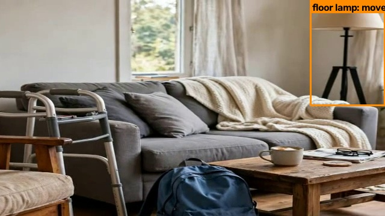
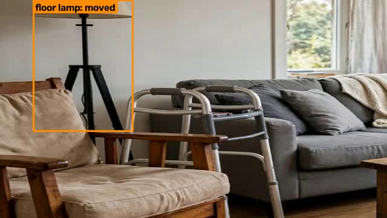
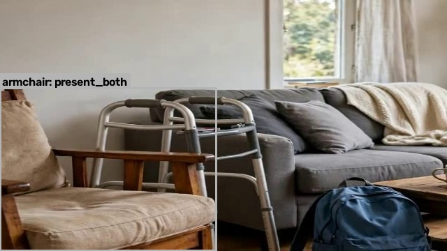

=== FILE: web/home.html ===
<!DOCTYPE html>
<html lang="en">
<head>
<meta charset="utf-8">
<meta name="viewport" content="width=device-width, initial-scale=1">
<title>Second Look — Did anything in Dad's room drift?</title>
<meta name="description" content="Film a parent's room on two visits. Second Look compares the walkthroughs with Meta's SAM 3.1 and Muse Spark — every finding with its evidence, or struck from the report.">
<link rel="preconnect" href="https://fonts.googleapis.com">
<link rel="preconnect" href="https://fonts.gstatic.com" crossorigin>
<link href="https://fonts.googleapis.com/css2?family=IBM+Plex+Mono:wght@400;500&family=Literata:opsz,wght@7..72,400;7..72,600&family=Public+Sans:wght@400;500;600&display=swap" rel="stylesheet">
<link rel="stylesheet" href="/web/app.css">
<link rel="stylesheet" href="/web/home.css">
</head>
<body>

<header class="site-bar">
  

    <a class="site-wordmark" href="/">Second Look</a>
    <nav class="site-nav" aria-label="Main">
      <a href="/app">Use your own videos</a>
      <a class="btn btn-primary site-cta" href="/app?sample=1">Try it now</a>
    </nav>
  

</header>

<main class="home-main">

  <!-- Hero -->
  <section class="hero" aria-labelledby="hero-heading">
    

      
Second Look

      <h1 id="hero-heading" class="hero-heading">Did anything in Dad&rsquo;s room drift since the last visit?</h1>
      
The person who visits isn&rsquo;t always the person who worries. Film the room the day it is set up safe. Next visit, anyone can film it again &mdash; a sibling, a neighbour, the aide &mdash; and Second Look shows what drifted, every finding with its evidence or struck from the report.

      

        <a class="btn btn-primary btn-large" href="/app?sample=1">Try it now</a>
        <a class="btn btn-large" href="/app">Use your own videos</a>
      

      
No account. No hardware. On our sample room a check took about a minute and about $0.33.

    

    

      <figure class="plate hero-plate">
        
        <figcaption>Last visit</figcaption>
      </figure>
      <figure class="plate hero-plate">
        
        <figcaption>Today &mdash; floor lamp moved</figcaption>
      </figure>
    

    
Real SAM 3.1 boxes, drawn on our synthetic test room.

  </section>

  <!-- Why this matters -->
  <section class="home-section" aria-labelledby="why-heading">
    

      

        <h2 id="why-heading" class="section-heading">Why this matters</h2>
        
About 1 in 4 adults over 65 falls each year, according to the CDC. Falls also come from strength, balance, medication and vision &mdash; home hazards are one modifiable factor among several, and a professional home-safety assessment stays the gold standard.

        
What a visit-by-visit check can catch is the slow drift in between: a walker pushed out of reach, clutter collecting on the floor along the bed-to-bathroom path, a lamp moved away from the bed. Drift is easy to miss when you are busy being glad to see each other.

      

      

        
Drift can create hazards. We show you the drift.

        
Second Look reports room changes. It does not claim to reduce falls, and it never replaces an OT home-safety check.

      

    

  </section>

  <!-- Three steps -->
  <section class="home-section" aria-labelledby="steps-heading">
    <h2 id="steps-heading" class="section-heading">Three steps. The check takes about a minute.</h2>
    <ol class="steps">
      <li class="step">
        

          <h3 class="step-title">Film the safe setup</h3>
          
A 20-second pan of the room, filmed after a discharge, a near-miss, or when a new walker arrives &mdash; the day it is set up the way the OT asked for. Say what must stay put: type it, or just speak it, and Second Look listens.

        

      </li>
      <li class="step">
        

          <h3 class="step-title">Film again next visit</h3>
          
The same slow pan from the doorway, lights on, bed-to-bathroom path included. The same corners matter more than the same angle &mdash; if we can&rsquo;t see something, we say not seen, never missing.

        

      </li>
      <li class="step">
        

          <h3 class="step-title">Read what drifted</h3>
          
High-risk items first. Every finding shows its evidence and ends with a plain &ldquo;Do this next&rdquo; step.

        

      </li>
    </ol>
    
Nothing to install. No account. Any phone, 15&ndash;30 seconds, lights on.

  </section>

  <!-- Receipts -->
  <section class="home-section" aria-labelledby="receipts-heading">
    

      <figure class="plate">
        
        <figcaption>Last visit &mdash; SAM 3.1 re-check found the armchair here, confidence 0.75</figcaption>
      </figure>
      

        <h2 id="receipts-heading" class="section-heading">Every claim shows its receipts</h2>
        
A reasoning model writes the report, but it is not allowed the last word. Each claim it makes is held against SAM 3.1 detections &mdash; boxes, frame numbers and confidences from your two videos. If the evidence agrees, the claim stays and carries its receipts with it.

        
If the evidence does not agree, the claim is not quietly deleted. It is crossed out in front of you, with the reason.

        

          

            Armchair &mdash; added
            <svg class="strike-svg home-strike-svg" viewBox="0 0 300 14" preserveAspectRatio="none" aria-hidden="true" focusable="false"><path class="home-strike-path" d="M2 8 C 40 5, 75 11, 112 7 S 190 5, 226 9 S 282 7, 298 6" pathLength="420"/></svg>
          

          
SAM&rsquo;s re-check found it in the first video (confidence 0.75). Struck.

        

        
Anything Second Look can&rsquo;t prove is crossed out in front of you, with the reason &mdash; so a quiet report means &ldquo;nothing proven changed&rdquo;, not &ldquo;the model felt confident&rdquo;.

      

    

  </section>

  <!-- Findings that lead to action -->
  <section class="home-section" aria-labelledby="alerts-heading">
    

      

        <h2 id="alerts-heading" class="section-heading">Findings that lead to action</h2>
        
High-risk findings surface first, gathered in a &ldquo;Needs attention&rdquo; banner at the top of the report &mdash; a walker out of reach outranks a moved plant. Every high or medium finding ends in &ldquo;Do this next&rdquo;: plain steps, such as moving the walker back within arm&rsquo;s reach of the bed and asking Dad to show you he can reach it.

        
Who should move it back? Only someone who is there, with Dad. If you are far away, send the report to someone local or the care team &mdash; never ask Dad to move furniture alone at night.

        
Done it? Mark it as sorted. The item stays on your watchlist and is checked again on the next visit; if it has drifted again, it comes back. And the summary is easy to share &mdash; text, email, or print for the care folder &mdash; so siblings who were not there see the same evidence.

      

      

        

          
High

          
Walker &mdash; moved

          
Do this next

          <ol class="attention-steps">
            <li>Move the walker back within arm&rsquo;s reach of the bed.</li>
            <li>Ask Dad to show you he can reach it.</li>
            <li>Re-film this corner &mdash; we&rsquo;ll confirm it&rsquo;s back.</li>
          </ol>
          
 Mark as sorted

        

        
Honestly stated: there are no push notifications and no background monitoring. Alerts appear when you run a check &mdash; on your visit, on purpose.

      

    

  </section>

  <!-- Private by design -->
  <section class="home-section" aria-labelledby="privacy-heading">
    <h2 id="privacy-heading" class="section-heading">Private by design</h2>
    

      
There is no installed camera and nothing recording between visits. Filming is deliberate, per visit &mdash; ideally with Dad, of rooms he is happy to share.

      
Clips are sent to Meta&rsquo;s model API only to find objects, using the standard model IDs (muse-spark-1.3, not muse-spark-1.3-contributor &mdash; see the code). There are no accounts, no ads and no analytics or ad scripts on this page or in the app.

      
The API key stays on the server, never in the browser. Reports and frames are stored on the machine running Second Look (in its outputs/ folder), under your control. The code is open source, so anyone can check all of this.

    

    
Not a medical device &mdash; it reports room changes, not health.

  </section>

  <!-- Who it is for -->
  <section class="home-section" aria-labelledby="who-heading">
    

      

        <h2 id="who-heading" class="section-heading">Who it is for</h2>
        
The daughter after Dad&rsquo;s hospital discharge.

        
The OT said: walker next to the bed, lamp within reach, path clear. She films that approved setup on discharge day, and on her next visit she gets a calm answer instead of trying to remember exactly where the lamp stood.

        
<strong>Dad&rsquo;s say:</strong> It is his home. Second Look flags change; Dad and the family decide what is unsafe. If he moved the lamp to read by his chair, that is the new setup, not drift.

      

      

        
Home-care nurses and OTs at follow-ups, with a printed report for the care record.

        
Siblings sharing visits, who want the same evidence in front of all of them.

        
The same engine also fits rental move-out checks.

      

    

  </section>

  <!-- How Meta's models work together -->
  <section class="home-section" aria-labelledby="models-heading">
    <h2 id="models-heading" class="section-heading">How Meta&rsquo;s models work together</h2>
    
Three models run it; two built it. 3 run it, 2 built it.

    <dl class="model-rows">
      

        <dt class="mono">muse-spark-1.3</dt>
        <dd><strong>Reasons.</strong> Takes the inventory of both rooms, suggests plainer names for hard-to-find objects, judges what moved, and writes the findings.</dd>
      

      

        <dt class="mono">sam-3.1</dt>
        <dd><strong>Proves.</strong> Tracks every named object through both videos, then re-checks anything that seemed to appear or vanish. Its boxes are the evidence &mdash; or the reason a claim is struck.</dd>
      

      

        <dt class="mono">muse-voice-transcribe-1.0</dt>
        <dd><strong>Listens.</strong> Turns a spoken care note (&ldquo;the walker must stay by the bed&rdquo;) into the watchlist, in about the time it takes to say it.</dd>
      

      

        <dt class="mono">muse-image-1.0</dt>
        <dd><strong>Built the test room.</strong> Generated our scoreable sample room &mdash; and its edited twin, with a backpack removed, a lamp moved and a suitcase added &mdash; so the sample check has a known right answer.</dd>
      

      

        <dt class="mono">muse-wonder-1.0</dt>
        <dd><strong>Wrote the code.</strong> The codebase was generated with Muse Wonder over reviewed rounds; the transcripts are public in the repository.</dd>
      

    </dl>
    

      
Two moments we verified by hand

      
Asked for a &ldquo;walker&rdquo;, SAM found nothing. Spark suggested the plainer alias &ldquo;metal walking frame&rdquo; &mdash; and SAM found it, at confidence 0.875.

      
SAM&rsquo;s video tracker missed the armchair in the first clip, which would have made it look newly added. Its image re-check caught the armchair at 0.75 &mdash; and the false claim was struck.

    

  </section>

  <!-- Honest numbers -->
  <section class="home-section" aria-labelledby="numbers-heading">
    <h2 id="numbers-heading" class="section-heading">Honest numbers</h2>
    
On our one scoreable test room (3 runs), the raw model invented claims 25&ndash;40% of the time; grounding struck every one.

    
A smoke test, not a benchmark &mdash; real-room recall is still untested. We would rather show you one small true number than a large vague one. A fresh check on the sample pair takes about a minute and about $0.33; past checks replay free from cache. The sample pair is pans over AI-generated stills; real, cluttered rooms are the next test.

  </section>

  <!-- FAQ -->
  <section class="home-section" aria-labelledby="faq-heading">
    <h2 id="faq-heading" class="section-heading">Questions families ask</h2>
    

      

        
Why a 20-second pan and not photos?

        
A short pan gives SAM 3.1 many frames of each object from slightly different angles, so a chair half-hidden in one still can still be tracked across the clip. It also matches what you already do on a visit &mdash; one slow look around the room &mdash; instead of asking you to photograph every corner.

      

      

        
Why not a camera in the room?

        
Because Dad lives there. An installed camera records between visits, whether or not anything is wrong; a phone pan happens on a visit, on purpose, ideally with him in the conversation. Deliberate filming also means consent is fresh every time, room by room.

      

      

        
Does &ldquo;seen where it was&rdquo; mean it&rsquo;s safe?

        
No &mdash; presence isn&rsquo;t reachability. Second Look can report that the walker is still beside the bed; it cannot tell whether Dad can reach it from lying down, whether the wheels are locked, or whether the path to it is clear at 2 a.m. That judgement stays with you and his OT.

      

      

        
What does &ldquo;not seen&rdquo; mean?

        
It means we couldn&rsquo;t confirm the item in this video &mdash; it may be out of frame, hidden behind furniture, or the light may have beaten us. It does not mean missing. Check in person before you worry.

      

      

        
What if it misses something?

        
That is the failure we worry about most: a struck false claim is harmless, but a silently missed &ldquo;walker moved&rdquo; is not. Recall on real, cluttered rooms is still untested, so treat Second Look as a supplement to your own look around &mdash; never a replacement for an OT home-safety check.

      

      

        
Is it a medical device?

        
No. Second Look reports room changes; it does not assess a person&rsquo;s health, diagnose anything, or replace a professional safety assessment.

      

    

  </section>

  <!-- Final CTA -->
  <section class="final-cta" aria-labelledby="final-heading">
    <h2 id="final-heading" class="final-heading">Take a second look</h2>
    
Start with the sample room &mdash; a known room with a known answer &mdash; and watch one claim get struck.

    
We don&rsquo;t watch Dad. We remember the room, so you can visit as his family, not his inspector.

    

      <a class="btn btn-primary btn-large" href="/app?sample=1">Try it now</a>
      <a class="btn btn-large" href="https://github.com/harshitaggarwal01/splatdiff">View the code on GitHub</a>
    

    
Engine: SplatDiff &middot; built for the Meta AI Developer Hackathon

  </section>

</main>

<footer class="home-footer">
  
Second Look &middot; <a href="/app">Open the app</a> &middot; <a href="https://github.com/harshitaggarwal01/splatdiff">GitHub</a>

  
Not a medical device &mdash; it reports room changes, not health.

</footer>

</body>
</html>
=== END FILE ===
=== FILE: web/index.html ===
<!DOCTYPE html>
<html lang="en">
<head>
  <meta charset="UTF-8">
  <meta name="viewport" content="width=device-width, initial-scale=1.0">
  <meta name="description" content="Second Look compares two room walkthroughs and reports what changed, with evidence for every finding.">
  <title>Second Look — Room check</title>
  <link href="https://fonts.googleapis.com/css2?family=Literata:opsz,wght@7..72,400;7..72,600&family=Public+Sans:wght@400;500;600&family=IBM+Plex+Mono:wght@400;500&display=swap" rel="stylesheet">
  <link rel="stylesheet" href="/web/app.css">
  
  
</head>
<body>
  

    <header class="masthead">
      

        

          <a class="wordmark" href="/" aria-label="Second Look — back to the product page">Second Look</a>
          Room check
        

        

          <time class="today mono" id="todayDate" datetime=""></time>
          <button type="button" class="btn btn-quiet" id="historyBtn" aria-expanded="false" aria-controls="historyDrawer">
            <svg class="icon" viewBox="0 0 24 24" fill="none" stroke="currentColor" stroke-width="1.5" stroke-linecap="round" stroke-linejoin="round" aria-hidden="true"><circle cx="12" cy="12" r="9"/><path d="M12 7v5l3 2"/></svg>
            Past checks
          </button>
        

      

      

        

          <h2 class="drawer-title">Past checks</h2>
          <button type="button" class="icon-btn" id="historyClose" aria-label="Close past checks">
            <svg class="icon" viewBox="0 0 24 24" fill="none" stroke="currentColor" stroke-width="1.5" stroke-linecap="round" aria-hidden="true"><path d="M5 5l14 14M19 5L5 19"/></svg>
          </button>
        

        

      

      <h1 class="promise">What changed in Dad&rsquo;s room since the last visit?</h1>
      
Film the room the day it is set up safe — after a hospital stay, a near-miss or a new walker. Next visit, anyone can film it again — a sibling, a neighbour, the aide — and you read the report wherever you are. Second Look shows what drifted, and every finding comes with its evidence or is struck from the report.

    </header>

    <main>
      <section class="intake" id="intake" aria-labelledby="intakeTitle">
        <h2 class="section-title" id="intakeTitle">The visit</h2>

        
Film the same route both times: start at the door, pan slowly to the bed, then along the path to the bathroom door. Lights on; keep each watchlist item in view for two seconds.

        

          

            

              <input type="file" id="fileBefore" accept="video/*" class="file-input" tabindex="-1" aria-hidden="true">
              

                <svg class="icon icon-lg" viewBox="0 0 24 24" fill="none" stroke="currentColor" stroke-width="1.5" stroke-linecap="round" stroke-linejoin="round" aria-hidden="true"><path d="M23 7l-7 5 7 5V7z"/><rect x="1" y="5" width="15" height="14" rx="2"/></svg>
                Last visit
                the safe setup, as the OT or nurse left it
                Click or drop a walkthrough video
              

              <video class="dropzone-video" id="videoBefore" controls playsinline preload="metadata" hidden></video>
              
            

          

          

            

              <input type="file" id="fileAfter" accept="video/*" class="file-input" tabindex="-1" aria-hidden="true">
              

                <svg class="icon icon-lg" viewBox="0 0 24 24" fill="none" stroke="currentColor" stroke-width="1.5" stroke-linecap="round" stroke-linejoin="round" aria-hidden="true"><path d="M23 7l-7 5 7 5V7z"/><rect x="1" y="5" width="15" height="14" rx="2"/></svg>
                Today
                Click or drop a walkthrough video
              

              <video class="dropzone-video" id="videoAfter" controls playsinline preload="metadata" hidden></video>
              
            

          

        

        

          <svg class="icon" viewBox="0 0 24 24" fill="none" stroke="currentColor" stroke-width="1.5" stroke-linecap="round" stroke-linejoin="round" aria-hidden="true"><circle cx="12" cy="12" r="9"/><path d="M12 11v5"/><circle cx="12" cy="8" r="0.5" fill="currentColor"/></svg>
          Why a 20-second pan? It sees behind chairs and along the floor. Nothing to install, nothing recording between visits.
        

        
Synthetic test room made with Muse Image, so every result can be scored. Real, cluttered rooms are the next test.

        

          

            <label class="field-label" for="tagInput">Must stay put</label>
            
Things that should stay put — his walker, night medicines, the phone.

            

              
              <input type="text" id="tagInput" class="tag-input" placeholder="Add: his walker, night medicines, the phone"
                     autocomplete="off" spellcheck="false" aria-label="Add an item that must stay put">
            

          

          

            Care notes
            
Say what matters and we will add it to the watchlist.

            

              <button type="button" class="btn btn-quiet" id="voiceBtn">
                <svg class="icon" viewBox="0 0 24 24" fill="none" stroke="currentColor" stroke-width="1.5" stroke-linecap="round" stroke-linejoin="round" aria-hidden="true"><path d="M12 1a3 3 0 0 0-3 3v8a3 3 0 0 0 6 0V4a3 3 0 0 0-3-3z"/><path d="M19 10v2a7 7 0 0 1-14 0v-2"/><path d="M12 19v4"/><path d="M8 23h8"/></svg>
                Speak your care notes
              </button>
              <button type="button" class="btn btn-quiet btn-stop" id="voiceStopBtn" hidden>
                <svg class="icon" viewBox="0 0 24 24" fill="none" stroke="currentColor" stroke-width="1.5" stroke-linecap="round" aria-hidden="true"><rect x="6" y="6" width="12" height="12" rx="1"/></svg>
                Stop
              </button>
              0:00
            

            

            <blockquote class="voice-quote" id="voiceQuote" hidden>
              Heard:
              
            </blockquote>
            <label class="check-row" for="narrationCheck">
              <input type="checkbox" id="narrationCheck">
              Also listen to what I said while filming
            </label>
          

        

        

          <button type="button" class="btn btn-primary" id="runBtn" disabled>
            Check the room
            <svg class="icon" viewBox="0 0 24 24" fill="none" stroke="currentColor" stroke-width="1.5" stroke-linecap="round" stroke-linejoin="round" aria-hidden="true"><path d="M5 12h14"/><path d="M13 6l6 6-6 6"/></svg>
          </button>
          <button type="button" class="btn btn-quiet" id="sampleBtn">
            <svg class="icon" viewBox="0 0 24 24" fill="none" stroke="currentColor" stroke-width="1.5" stroke-linecap="round" stroke-linejoin="round" aria-hidden="true"><polygon points="6 3 20 12 6 21 6 3"/></svg>
            Use the sample room
          </button>
          
Film with Dad&rsquo;s knowledge — ideally together. Clips are sent to Meta&rsquo;s model API to find objects.

          

        

      </section>

      <section class="live" id="liveSection" aria-labelledby="liveTitle" hidden>
        <h2 class="section-title" id="liveTitle">The check, as it happens</h2>
        <ol class="stage-list" id="stageList"></ol>
        
elapsed 0.0 s · cost $0.00 · models used: —

        

          

          <button type="button" class="btn btn-quiet" id="retryBtn">Try again</button>
        

      </section>

      <section class="report" id="reportSection" aria-labelledby="reportSummary" hidden>
        

        
Second Look — Room check

        <h2 class="report-summary" id="reportSummary"></h2>
        

        

          <h3 class="report-heading">Care watchlist</h3>
          

        

        

          <h3 class="report-heading">What changed</h3>
          
No changes could be proven from the evidence in these two walkthroughs.

          

        

        

          <h3 class="report-heading">Struck from the report</h3>
          
These were suggested during the check but the SAM&nbsp;3.1 evidence did not support them, so they were removed.

          

        

        <footer class="report-footer">
          

          
Second Look reports changes in the room, not health, and is not a medical device. For a high finding: put things back, tell the family, and ask Dad&rsquo;s OT or nurse if you are unsure.

          

            <button type="button" class="btn btn-quiet" id="printBtn">
              <svg class="icon" viewBox="0 0 24 24" fill="none" stroke="currentColor" stroke-width="1.5" stroke-linecap="round" stroke-linejoin="round" aria-hidden="true"><path d="M6 9V2h12v7"/><path d="M6 18H4a2 2 0 0 1-2-2v-5a2 2 0 0 1 2-2h16a2 2 0 0 1 2 2v5a2 2 0 0 1-2 2h-2"/><rect x="6" y="14" width="12" height="8"/></svg>
              Print for family
            </button>
            <button type="button" class="btn btn-quiet" id="copyBtn">
              <svg class="icon" viewBox="0 0 24 24" fill="none" stroke="currentColor" stroke-width="1.5" stroke-linecap="round" stroke-linejoin="round" aria-hidden="true"><rect x="9" y="9" width="13" height="13" rx="2"/><path d="M5 15H4a2 2 0 0 1-2-2V4a2 2 0 0 1 2-2h9a2 2 0 0 1 2 2v1"/></svg>
              Copy summary
            </button>
            <button type="button" class="btn btn-quiet" id="shareBtn">
              <svg class="icon" viewBox="0 0 24 24" fill="none" stroke="currentColor" stroke-width="1.5" stroke-linecap="round" stroke-linejoin="round" aria-hidden="true"><circle cx="18" cy="5" r="3"/><circle cx="6" cy="12" r="3"/><circle cx="18" cy="19" r="3"/><path d="M8.6 13.5l6.8 4M15.4 6.5l-6.8 4"/></svg>
              Send to family
            </button>
          

        </footer>
      </section>
    </main>

    <footer class="colophon">
      
Every finding above is held to its SAM&nbsp;3.1 evidence. If the evidence is not there, the finding is struck — never guessed.

    </footer>
  

</body>
</html>
=== END FILE ===
=== FILE: VIDEO_SCRIPT.md ===
# Second Look — 3-minute demo script (v3)

Total running time: 3:00 maximum. Narrate plainly; let the screen carry the detail. Max 2 jargon terms on camera ("grounded or dropped" is the one to keep). Buttons on screen: *Use the sample room*, *Check the room*, *Past checks*, *Speak your care notes*.

**Tip before recording:** replay the armchair run from *Past checks* so the ink-strike always appears on cue, even if a fresh live run behaves differently on the day.

**0:00–0:15 — Hook, over the struck armchair.** Open on the report with the armchair claim already struck through, before/after frames behind it. "Last month this lamp stood by the sofa. This month it is across the room — and nobody noticed. We filmed twice. Watch what drifted, and watch one claim get struck because the evidence was not there."

**0:15–0:45 — The ink-strike hero.** Stay on the struck claim; let the ink-strike animation replay. "The AI said an armchair appeared. It didn't — SAM's re-check found it in the first video, at confidence 0.75. Video tracking had missed it there; the image re-check overturned the claim before it reached the family." Point at the reason line under the strike. "Struck, reason shown. That is the whole product in one moment: every finding shows its evidence, or it is struck from the report in front of you." One line on the test room, on screen as a label: "Synthetic test room (Muse Image) — Scored on one synthetic room so we know the right answer; real, cluttered rooms are the next test." The sample pair (`data/sample_before.mp4`, `data/sample_after.mp4`) changed exactly three scoreable things: the blue backpack was removed, the floor lamp moved next to the armchair, and a red suitcase appeared.

**0:45–1:00 — Real phone footage beat.** [PLACEHOLDER: user's real clips] Show 10–15 seconds of a real handheld phone walkthrough pair — a real room, a lamp and a bag moved between clips. On-screen label throughout: "Synthetic test room (Muse Image) — Scored on one synthetic room so we know the right answer; real, cluttered rooms are the next test." applies to the sample segments; label this beat "Real phone footage". Voiceover, one breath: "No camera watching him sleep, no hardware to install. You film for 20 seconds when you visit, with Dad; nothing is recorded between visits." Founder answer, near 0:45, verbatim: "If you are the one visiting, Second Look is not there to out-see you — it is there because nobody remembers exactly where the walker stood three weeks ago. Film the safe setup once, film again next visit, and send the same receipts to the sibling who was not there."

**1:00–1:20 — Voice note to watchlist.** Open the Care dossier UI at `http://127.0.0.1:8000`. Click *Use the sample room*, then *Speak your care notes* and play the spoken care note: "Please keep an eye on the walker — it must stay next to the bed." Muse Voice Transcribe (`muse-voice-transcribe-1.0`) transcribes it (a 10-second note takes about 2.3 s), and Muse Spark turns it into a watchlist item: *walker — must stay put*. "Her hands were holding the phone, filming. The watchlist is spoken, not typed. Watchlist items are always tracked and always reported first."

**1:20–1:45 — Live check, compressed, plus vocabulary repair.** Click *Check the room*. Do not narrate the plumbing — let the chips fill in, accelerating: normalising, keyframes, inventory, tracking, re-checks, judging, reporting. One line only: "Spark inventories the room; SAM tracks every object in both videos; anything that seems to appear or vanish gets a second look." Then slow down for the walker chip: "Here SAM didn't know the word *walker* — it returned nothing. Spark taught it a new phrase, 'metal walking frame', SAM re-ran, and found it at confidence 0.875. The models need each other: one reasons, one proves."

**1:45–2:25 — Report: HIGH finding, evidence, next step.** Open the finished report. Watchlist first: walker — *in place*, with its status in plain language (*"Seen where it should be. We can't check it's reachable or working."*). Then the HIGH finding (floor lamp moved / walker-class finding as the run presents it), high-risk first. Say: "High does not mean emergency — it means look first. If you are far away, send this to someone local; never ask Dad to move furniture alone." Open the evidence board and show one finding up close: before and after frames with the SAM box drawn, frames seen, confidences. Then land on the block under the HIGH finding: **Do this next** — "Move the walker back within arm's reach of the bed. Ask Dad to show you he can reach it. Then re-film this corner — we'll confirm it's back." Tap **Mark as sorted**. "A report that ends at detection is a demo. This one ends at: here is what to do, tell us when it's done, and we re-check it next visit." If an item shows `not_seen`, say the line printed under it: "Not seen in this video — not the same as missing. Check before you worry."

**2:25–2:45 — Honest numbers.** Show the eval summary once, no ticker. Say it exactly like this: "On our one scoreable test room (3 runs), the raw model invented claims 25–40% of the time; grounding struck every one — a smoke test, not a benchmark. Recall on a real, cluttered room is untested, and a missed walker matters more than a false alarm. A fresh check takes about a minute and about $0.33; replaying a past check is free."

**2:45–3:00 — Close: 3 run it, 2 built it.** "Three Meta models run every check: Muse Spark reasons, SAM 3.1 proves, Muse Voice Transcribe listens. Two more built it: Muse Image made our scoreable synthetic test room, and Muse Wonder wrote the codebase — about 13 reviewed generation rounds, parallel workers, transcripts and even the red-team critique in `build_log/`. Second Look is not a medical device — it reports what drifted, with receipts, or it strikes the claim. We don't watch Dad. We remember the room, so you can visit as his family, not his inspector."
=== END FILE ===