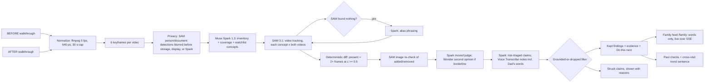

=== FILE: README.md ===
# Second Look — What changed in Dad's room?

Second Look compares two short phone walkthroughs of the same room — a BEFORE and an AFTER — and reports which objects were **added**, **removed**, or **moved**. Every kept finding is backed by SAM 3.1 detections (boxes, frame ids, confidences). Any claim the reasoning model makes that SAM evidence does not support is **dropped and shown as dropped**, struck through with the reason, in a section called "Struck from the report".

SplatDiff is the engine codename from the author's earlier 3D-scene research; this product uses no Gaussian splats.

The lead story: Dad is 82 and lives alone. After a hospital discharge or a near-miss, his daughter films the OT-approved safe setup as a baseline — walker next to the bed, lamp within reach, path to the bathroom clear. On her next visit she films again. Second Look shows her what drifted in between: is the walker still within reach, has clutter appeared on the floor, was the lamp moved away from the bed?

**The grounded room-change check is the working product.** The glasses view described below is "Dad's point of view" — a working simulation, not a Meta product integration.

## Why

The CDC reports that about 1 in 4 adults aged 65+ falls each year, and home hazards are a modifiable risk factor. Families often visit periodically, and slow drift between visits goes unnoticed: a walker pushed out of reach, clutter building up on the floor. Drift can create hazards. Second Look does not claim to reduce falls — it detects object drift, and drift is one factor among many (strength and balance, medications, vision and blood pressure all matter too, which is why an OT assessment remains the gold standard).

A false alarm wastes trust; a miss can matter far more. So Second Look follows one rule — **grounded or dropped**: a finding is kept only if SAM 3.1 evidence supports it, and everything else is shown struck, with the reason, rather than hidden. And because a missed "walker moved" is the catastrophic error here, we say plainly: **false negatives matter more than false positives.** Our grounding story is about killing false claims; it says nothing yet about recall in a real, cluttered room, which is untested.

You do not need two walkthroughs on day one. Value starts at visit #2. Film today's safe room as the baseline; next visit, we show you what drifted.

## The product, by route

Run `python server.py`, then:

| Route | What it is |
|---|---|
| `/` | Product page, with **Try it now**. |
| `/app` | The Care dossier app — the working room-change check described below. |
| `/family` | The family feed — words only, never pictures, live over SSE. |
| `/glasses` | "Dad's point of view" — a working **simulation** of a glasses-style view (see below). Not a Meta product integration. |

## The Care dossier app (`/app`)

One room at a time, built around how visits actually work:

- **Rooms, filmed by, saved baseline per room.** Each check names the room (Bedroom, Hallway, Kitchen…) and who filmed it. A room can keep a saved baseline; compare later visits against it instead of re-uploading the "before" clip. **"This is the new setup"** promotes a finished check's "after" state to become the room's new baseline when Dad's setup legitimately changes.
- **Record with this phone.** Film either walkthrough in the browser instead of uploading a file.
- **Watchlist, typed or spoken.** The things that must stay put — walker, lamp, medication basket — typed in, or spoken as a care note and transcribed with Muse Voice Transcribe (`muse-voice-transcribe-1.0`), including diarization, so who said what is preserved. That matters: when **Dad's own words** explain a change — *"I moved the lamp so I can read by my chair"* — the finding is marked as **his choice, with low risk**, instead of being flagged at the family as drift. Dad narrating his own room is evidence, not just audio.
- **Privacy blur before anything is stored, shown or sent on.** People and paper documents detected in frames are blurred before any frame is stored, shown, or sent to Muse Spark for reasoning. On the sample pair, **2 documents were blurred**. (SAM 3.1 itself sees the raw frame because it is the detector doing the blurring.) Raw videos are **deleted by default** after the check; keeping them is opt-in. Any check can be deleted ("Delete a check").
- **Coverage check, with a retake tip.** Before trusting a diff, Second Look checks the two walkthroughs actually cover the same corners, and tells you what to re-film if they don't ("re-film the bathroom door"). On the sample pair the coverage score is **0.9**. A low-coverage diff is labelled as such rather than presented as fact.
- **Grounded floor-clutter check.** Objects claimed to be on the floor in a walking path must be proven by SAM detections low in the frame; unproven clutter claims are struck like everything else.
- **SAM vocabulary repair.** SAM does not always know a family's word. When a watchlist concept returns nothing, Muse Spark proposes a phrasing SAM can segment and SAM re-runs. Verified: **"walker" → "metal walking frame", found at c 0.875**.
- **Image re-check strike.** Added/removed claims get a second, image-level SAM check on frames from the side where the object supposedly wasn't. Verified: an "armchair added" claim was struck when the image re-check found the armchair in the BEFORE frames at **c 0.75** — video tracking had simply missed it.
- **Muse Wonder second opinions and trends.** Borderline "moved" calls get a Muse Wonder (`muse-wonder-1.0`) second opinion at runtime rather than a coin-flip threshold, and a cross-visit **trend sentence** summarises how a room is drifting over successive checks.
- **Acting on a finding:** a **Needs-attention banner** when anything is high-risk; **Do this next** on every serious finding, **ask Dad first** before treating a change as a problem; **Mark as sorted** when it's handled; **Send to family**; **Print** a plain-language report.
- **Past checks** per room, and **`.ics` re-film reminders** (download a calendar file: "re-film Dad's bedroom") so the next visit actually happens.

## The family feed (`/family`)

For the family who weren't there:

- **Words only, never pictures.** No frames, no video, no transcripts — just findings in plain sentences, each traceable back to evidence in the app.
- **Live over SSE, within a minute** of a check finishing. An opt-in browser notification announces new entries (only if the family member turns it on).
- **Fall alerts can land here — from a better sensor.** A fall alert from *any* sensor — watch, pendant, radar, or glasses — can be posted to this same family feed after an **"Are you OK?" check-in**. Plainly: **glasses are a poor fall sensor** — they are off or charging at night and in the bathroom, exactly when serious falls cluster, and head motion is not body impact. Fall detection is partner territory; in the demo it is **simulated**, and Second Look does not claim to detect falls.
- **"Ask about Dad's room"** — an agent grounded in the words feed. It answers with citations to feed entries and careful language: something was **"seen where it was"** at a stated time, not guaranteed to be there now.
- **"Write an update for"** — one click drafts an update calibrated to the reader: **nearby** family (practical, who can pop in), **far away** family (reassuring, fuller context), or **Dad** — written *to* him, not about him.

## Dad's point of view: the glasses simulation (`/glasses`)

`/glasses` is a **working simulation** of what this product becomes from Dad's point of view — labelled as a simulation, running on this laptop with a phone-style camera view, **not** a Meta product integration and not running on Meta glasses.

What is real in the simulation:

- **Real SAM 3.1 calls per frame, ~0.9 s per frame.** The simulated glasses view runs the same detector as the room check — nothing is canned.
- **Whispered watchlist prompts in Dad's ear**, e.g. *"Walker — on your left, close."* Position and proximity from the frame, spoken quietly, hands-free.
- **"Where did I leave it?"** — a tab-only last-seen memory. Ask where the keys / glasses / walker were last seen and it answers only from what the camera actually saw, in honest language: *"Last seen 6:04 pm on the kitchen table — not seen since."* Never "your keys are…" as present truth. Last seen is not current location, and for medication it is never evidence of taking anything: check before taking.

**Roadmap, stated as roadmap:** live glasses streaming via **Meta's Wearables Device Access Toolkit** is the intended next capture surface. It is not built, not demoed as built, and judges should score it as a direction, not a feature.

## How Meta's models work together

**4 run it, 2 built it.**

Four Meta models run the product:

| Model | Role |
|---|---|
| `muse-spark-1.3` (reasons) | Room inventory from keyframes; coverage judging; vocabulary-repair aliases; pairwise moved judgement relative to surrounding furniture; risk-triaged report, next steps, and feed wording. |
| `sam-3.1` (proves) | Text-prompted video tracking of every object in both walkthroughs; image re-checks; privacy blurring detections; floor-clutter verification; per-frame detections in the glasses simulation. |
| `muse-voice-transcribe-1.0` (listens) | Spoken watchlists and care notes, with diarization — so Dad's own explanation marks a finding as his choice (low risk). |
| `muse-wonder-1.0` (second opinion) | Second opinions on borderline "moved" calls, and the cross-visit trend sentence. |

Two more built it:

| Model | Role |
|---|---|
| `muse-image-1.0` | Generated the synthetic test room and its edited "after" version used for the sample pair and ground truth. |
| `muse-wonder-1.0` | Wrote the codebase — **~25 reviewed generation rounds with up to 5 parallel workers**, each round reviewed and run by a human, **plus 3 red-team critique rounds by Muse Wonder and Muse Spark** (`build_log/`), including the critique that produced the glasses positioning in this README. |

Verified model-needs-model moments: SAM returned nothing for "walker"; Spark's "metal walking frame" let SAM find it at c 0.875. SAM video tracking missed the armchair in BEFORE; its own image re-check found it at c 0.75 and struck Spark's "armchair added" claim.

## Architecture



The grounding filter: `added` kept only if SAM's label is `added`; `removed` only if `removed`; `moved` only if SAM says `present_both` **and** the moved verdict holds (with a Wonder second opinion on borderline calls). Unmentioned SAM-only added/removed changes are added back as kept claims with `source: "sam"`. Every Meta API call is logged to `cache/costs.jsonl`, and Responses calls are disk-cached in `cache/responses/` (`SPLATDIFF_NO_CACHE=1` disables), making replays free and instant.

## Honest numbers

On our one scoreable test room (3+ runs), the raw model invented 25–40% of claims; grounding struck every one — **a smoke test, not a benchmark**. Real cluttered rooms are untested, and recall there — the number that matters most, since a missed "walker moved" is the catastrophic error — is unknown. A fresh sample check takes **~1–1.5 min and ~$0.24–0.33**; cached replays are free and instant.

## Setup

```bash
pip install -r requirements.txt
cp .env.example .env   # fill in MODEL_API_KEY
python server.py       # Care dossier UI at http://127.0.0.1:8000
```

Gradio fallback UI:

```bash
python app.py
```

Synthetic sample pair (Muse Image stills + Ken-Burns pan videos; generation is skipped if `data/before.jpg` / `data/after.jpg` already exist):

```bash
python scripts/make_synthetic.py
```

CLI:

```bash
python -m splatdiff.pipeline before.mp4 after.mp4
python -m splatdiff.pipeline before.mp4 after.mp4 --concepts "floor lamp,backpack,walker"
```

Eval (fuzzy concept match; precision/recall/F1 for raw vs grounded claims, hallucinated-claim rate, cost, latency → `outputs/eval.md`):

```bash
python eval.py --gt data/gt.json --result outputs/<run>/result.json
python eval.py --gt data/gt.json --run before.mp4 after.mp4
```

Outputs land in `outputs/<run_id>/`: `result.json`, `report.md`, and annotated frames `before_<concept>.jpg` / `after_<concept>.jpg` with coloured boxes and labels (green added, red removed, orange moved).

## Limitations

- Viewpoint differences between the two handheld clips make "moved" the weakest call; the judge compares position relative to surrounding furniture rather than pixels.
- SAM recall on small or partly hidden objects is imperfect; a missed detection can flip a label, which the image re-check only partly mitigates. False negatives matter more than false positives in this product, and recall on real cluttered rooms is untested.
- Presence is not safety: a detected object may be unreachable, blocked or not working, and object detection cannot see states or absences such as a loose rug edge or a spill. "Seen where it was" is a sighting, not a guarantee.
- The glasses view is a simulation on `/glasses`. Live streaming via Meta's Wearables Device Access Toolkit is roadmap only; no Meta glasses integration exists in this repo.
- Glasses are a poor fall sensor (off/charging at night and in the bathroom; head motion ≠ body impact). Fall alerts in the feed are simulated and are partner territory (watch, pendant, radar).
- Last-seen memory only knows what the camera saw; drawers, dark rooms, charging gaps and other people moving things break the chain. It never answers medication questions beyond last-seen location and time.
- Boxes, not masks: mask payload encoding is undocumented, so evidence is box-level, not pixel-level.
- The 30 s cap at 5 fps bounds cost and latency but can miss detail.
- English voice notes only tested.
- Not a medical device. Second Look reports room changes; it does not assess a person's health or replace a professional safety assessment. Consent is per visit: ask together, film together; nothing is recorded between visits.

## Prior work disclosure

The author's earlier research on object-change detection in 3D scenes motivated this idea; no code, data, or figures from it are used — everything in this repo was written during the hackathon (Nov 4, 2026).
=== END FILE ===
=== FILE: VIDEO_SCRIPT.md ===
# Second Look — 3-minute demo script (final)

Total: 3:00 maximum. One jargon phrase to keep: "grounded or dropped." Label every simulation as a simulation, on screen and out loud. Tip: replay a Past check for the strike so the ink-strike lands on cue.

**0:00–0:20 — Hook, on the lamp.** Open on the finished report, floor lamp finding highlighted. "Last month this lamp stood by Dad's bed, where he reads. This month it's across the room — and nobody noticed. His daughter filmed the room twice. Watch what drifted — and watch one claim get struck, because we couldn't prove it."

**0:20–0:45 — Struck-claim hero (done by 0:45).** The armchair claim, struck through. "The AI said an armchair had appeared. It hadn't. SAM's image re-check found it in the first video — confidence 0.75 — and the claim was struck, reason shown, before it reached the family. That's the whole product: if we can't show where we saw it, we don't say it." Small on-screen label: "Synthetic test room — real cluttered rooms untested."

**0:45–1:00 — Founder answer.** To camera, plainly: "People ask why the daughter doesn't just look. Because **the person who visits isn't always the person who worries.** She films for twenty seconds; her brother three hundred miles away gets the same receipts she does. And nobody — nobody — remembers exactly where the walker stood three weeks ago."

**1:00–1:35 — Live check, compressed.** `/app`: room Bedroom, saved baseline already there, record/upload the new walkthrough, hit Check. Compress the live stages (privacy blur — "people and papers blurred before anything is stored or sent on; two documents blurred on this sample" — coverage 0.9, tracking). Slow down once: "SAM didn't know the word 'walker.' Spark taught it 'metal walking frame' — found, 0.875. One model reasons; one proves." Land on the report: Needs-attention banner, floor clutter checked, **Do this next** — "ask Dad first" — **Mark as sorted**.

**1:35–1:55 — Dad's own words.** Play the spoken care note / room narration. Transcription with diarization separates Dad's voice: *"I moved the lamp so I can read by my chair."* The lamp finding flips to **his choice — low risk**. "That's not drift. That's Dad, in his own words, and the report treats it that way. His words outrank our inference."

**1:55–2:20 — Family feed, live.** Switch to `/family` on a second screen/phone. The check lands live over SSE — words only, never pictures. Tap **Ask about Dad's room**: "Was the lamp seen where it was?" Answer with citation, in "seen where it was" language. Then **Write an update for Dad** — show the draft: written *to* him, not about him. ("Far away" variant in one glance if time is short.) Optional 5-second beat, labelled SIMULATED: a fall alert from a watch lands on the feed after an "Are you OK?" check-in. "Glasses are a poor fall sensor — off at night, head motion isn't a fall. That's partner territory; this is simulated."

**2:20–2:40 — Glasses simulation (20 s, labelled SIMULATION).** `/glasses`, on-screen banner: SIMULATION — DAD'S POINT OF VIEW. Real SAM 3.1 per frame, ~0.9 s. The whisper: *"Walker — on your left, close."* Then switch to the **"Where did I leave it?"** tab: "Where are my keys?" → "Last seen 6:04 pm on the kitchen table — not seen since." Say it plainly: "A simulation on a laptop today. Live streaming through Meta's Wearables Device Access Toolkit is roadmap — not built, and we're not pretending otherwise."

**2:40–3:00 — Close.** Back to the struck claim, one beat. "On one synthetic room, over three-plus runs, the raw model invented a quarter to two-fifths of its claims. Grounding struck every one — a smoke test, not a benchmark; real rooms are next. A fresh check: about a minute, about thirty cents. **Second Look is Dad's second memory: it remembers where his walker stood, what drifted, and what Dad himself chose to move — and if we can't show where we saw it, we don't say it.**"
=== END FILE ===
=== FILE: build_log/SUBMISSION_DRAFT.md ===
# Submission draft — final

## Name

**Second Look**

## Tagline

What changed in Dad's room? Two phone walkthroughs in, a grounded change report out — every finding backed by SAM 3.1 evidence, or struck, reason shown.

## Description (150 words)

Second Look helps families notice what changed in an older parent's room between visits. A daughter films a safe baseline — walker by the bed, lamp within reach, floor path clear — then films again next visit. Muse Spark reasons about the room, SAM 3.1 proves each finding with boxes, frames and confidences, Muse Voice Transcribe listens to spoken watchlists and Dad's own words, and Muse Wonder gives second opinions on borderline calls. Unsupported claims are struck, reason shown. Findings include watchlist status, floor clutter, coverage gaps, privacy blurring, and a plain next step. Words-only updates reach family live, without pictures. A simulated glasses view shows Dad's point of view and honest last-seen memory. It is not a medical device, fall detector, or replacement for professional assessment. If we cannot show where we saw it, we do not say it to family or Dad. That rule always protects trust during every check.

## The product

- **Care dossier app (`/app`)** — rooms, who filmed it, a saved baseline per room, "This is the new setup" re-baselining, record-with-this-phone capture, watchlist typed or spoken, Needs-attention banner, Do this next (ask Dad first), Mark as sorted, Send to family, Print, Past checks, delete a check, `.ics` re-film reminders. Raw videos deleted by default.
- **Privacy first** — people and paper documents blurred by SAM before any frame is stored, shown, or sent to Muse Spark (2 documents blurred on the sample). Muse Voice Transcribe with diarization means Dad's own words ("I moved the lamp so I can read by my chair") mark a finding as his choice, low risk.
- **Grounded checks** — coverage score with retake tip (0.9 on the sample), grounded floor-clutter check, SAM vocabulary repair (walker → "metal walking frame", c 0.875), image re-check strikes (armchair found in BEFORE at c 0.75), Muse Wonder second opinions on borderline "moved" calls, and a cross-visit trend sentence.
- **Family feed (`/family`)** — words only, never pictures; live over SSE within a minute; opt-in browser notifications; "Ask about Dad's room" agent grounded in the feed with citations and "seen where it was" language; "Write an update for" nearby / far away / Dad — written to him, not about him.
- **Glasses simulation (`/glasses`)** — "Dad's point of view": a working simulation, not a Meta product integration. Real SAM 3.1 calls per frame (~0.9 s), a whisper ("Walker — on your left, close."), and a tab-only "Where did I leave it?" last-seen memory that answers "last seen … not seen since." Live glasses streaming via Meta's Wearables Device Access Toolkit is **roadmap**.
- **Falls** — a fall alert from any sensor (watch, pendant, radar or glasses) can land on the family feed after an "Are you OK?" check-in. Glasses are a poor fall sensor (night/bathroom, charging, head motion ≠ body impact); fall detection is partner territory and is simulated in the demo. Second Look does not detect falls.
- Product page at `/` with Try it now. Run with `python server.py`.

## Models — 4 run it, 2 built it

**Run it:** `muse-spark-1.3` reasons (inventory, coverage, moved judgements, report, feed wording); `sam-3.1` proves (video tracking, image re-checks, privacy blur, floor clutter, glasses-simulation frames); `muse-voice-transcribe-1.0` listens (spoken watchlists, diarized care notes, Dad's own words); `muse-wonder-1.0` gives runtime second opinions on borderline "moved" calls and writes the cross-visit trend sentence.

**Built it:** `muse-image-1.0` generated the synthetic test room; `muse-wonder-1.0` wrote the code — ~25 reviewed generation rounds with up to 5 parallel workers, plus 3 red-team critique rounds by Muse Wonder and Muse Spark in `build_log/`, one of which forced the glasses-as-simulation positioning.

## Challenges

- **Grounding, not prompting.** A deterministic diff (present = 2+ frames at c ≥ 0.5) plus a filter that strikes any Spark claim SAM evidence doesn't support — added/removed must match the SAM label; "moved" needs present-in-both plus a moved verdict, with a Wonder second opinion when borderline. Struck claims stay visible with reasons.
- **Vocabulary mismatch.** SAM segments what it can name; "walker" returned nothing until Spark proposed "metal walking frame" (c 0.875).
- **Tracker misses.** Video tracking missed the armchair in BEFORE; SAM's image re-check found it (c 0.75) and struck a false "added" claim.
- **Consent and privacy by architecture.** Per-visit filming, blur-before-storage, delete-by-default video, words-only family feed — surveillance-shaped features were cut, not policy-patched.
- **Honesty under demo pressure.** The glasses pivot critique (`build_log/critique_pivot_glasses.md`) killed a five-feature glasses pitch; what survived is a labelled simulation, a roadmap line, and falls handed to partners.

## Limitations

One synthetic room, 3+ runs — a smoke test, not a benchmark. The raw model invented 25–40% of claims; grounding struck every one, but real cluttered rooms are untested and recall there (a missed "walker moved" is the catastrophic error) is unknown. "Moved" is the weakest call under viewpoint change. Presence is not safety; last-seen is not current location; nothing here detects falls, assesses health, or replaces an OT assessment. The glasses experience is simulated; live Wearables Device Access Toolkit streaming is roadmap. A fresh sample check takes ~1–1.5 min and ~$0.24–0.33; replays are cached, free and instant.

## X post (≤280 characters)

Second Look: film Dad's room this visit, film again next visit. We report what drifted — every finding backed by SAM 3.1 evidence, or struck, reason shown. If we can't show where we saw it, we don't say it. Not a medical device.

## 2-tweet thread

**1/** The person who visits isn't always the person who worries. Second Look compares two phone walkthroughs of Dad's room and reports what was added, removed or moved — watchlist first, floor checked, papers and people blurred before anything is stored or shared.

**2/** Every claim carries SAM 3.1 boxes, frames and confidences, or it's struck in front of you. On one synthetic room (3+ runs) the raw model invented 25–40% of claims; grounding struck every one — smoke test, not a benchmark. 4 Meta models run it, 2 built it.
=== END FILE ===