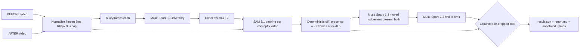

=== FILE: splatdiff/__init__.py ===
"""SplatDiff: grounded video change detection."""
__version__ = "1.0.0"
__all__ = ["__version__"]
=== END FILE ===

=== FILE: splatdiff/meta_api.py ===
"""Meta Model API client: retries, disk cache, cost ledger."""
from __future__ import annotations
import base64, hashlib, json, logging, os, time
from pathlib import Path
import requests
from dotenv import load_dotenv

load_dotenv()
log = logging.getLogger("splatdiff.meta_api")
BASE_URL = "https://api.meta.ai/v1"
CACHE_DIR = Path("cache")
RESP_CACHE = CACHE_DIR / "responses"
COSTS_FILE = CACHE_DIR / "costs.jsonl"
FILES_CACHE = CACHE_DIR / "files.json"
_session = requests.Session()

def _api_key() -> str:
    key = os.getenv("MODEL_API_KEY", "")
    if not key:
        raise RuntimeError("MODEL_API_KEY is not set. Copy .env.example to .env and fill it in.")
    return key

def _headers() -> dict:
    return {"Authorization": f"Bearer {_api_key()}", "Content-Type": "application/json"}

def _no_cache() -> bool:
    return os.getenv("SPLATDIFF_NO_CACHE", "") == "1"

def _cache_key(body: dict) -> str:
    raw = json.dumps(body, sort_keys=True, ensure_ascii=False).encode("utf-8")
    return hashlib.sha256(raw).hexdigest()

def _estimate_cost(body: dict, resp: dict | None) -> tuple[float, str]:
    model = str(body.get("model", "unknown"))
    if model == "muse-spark-1.3":
        usage = (resp or {}).get("usage") or {}
        try:
            it, ot = float(usage.get("input_tokens", 0)), float(usage.get("output_tokens", 0))
        except Exception:
            it, ot = 0.0, 0.0
        return (it * 1.25 + ot * 4.25) / 1_000_000.0, "responses"
    if model == "sam-3.1":
        s = json.dumps(body)
        if "input_video" in s:
            return max(50, 150) * 0.20 / 1000.0, "video_segmentation"
        return 2.50 / 1000.0, "image_segmentation"
    if model.startswith("muse-image"):
        return 0.01, "image"
    return 0.0, "responses"

def _log_cost(model: str, kind: str, est_usd: float, latency_s: float) -> None:
    try:
        CACHE_DIR.mkdir(parents=True, exist_ok=True)
        row = {"model": model, "kind": kind, "est_usd": round(float(est_usd), 6),
               "latency_s": round(float(latency_s), 3), "ts": time.strftime("%Y-%m-%dT%H:%M:%S%z")}
        with COSTS_FILE.open("a", encoding="utf-8") as f:
            f.write(json.dumps(row) + "\n")
    except Exception as e:
        log.warning("cost ledger failed: %s", e)

def total_cost() -> float:
    try:
        return sum(float(json.loads(l).get("est_usd", 0)) for l in COSTS_FILE.read_text(encoding="utf-8").splitlines() if l.strip())
    except Exception:
        return 0.0

def responses(body: dict) -> dict:
    """POST /v1/responses with cache, retries on 429/5xx/timeout, never retry 400."""
    RESP_CACHE.mkdir(parents=True, exist_ok=True)
    key = _cache_key(body)
    cache_path = RESP_CACHE / f"{key}.json"
    if not _no_cache() and cache_path.exists():
        try:
            log.info("cache hit %s", key[:12])
            return json.loads(cache_path.read_text(encoding="utf-8"))
        except Exception as e:
            log.warning("bad cache file, refetching: %s", e)
    url = f"{BASE_URL}/responses"
    last_err = None
    for attempt in range(3):
        start = time.time()
        try:
            r = _session.post(url, headers=_headers(), json=body, timeout=300)
            latency = time.time() - start
            if r.status_code == 400:
                print(f"Meta API 400 error body: {r.text[:4000]}")
                r.raise_for_status()
            if r.status_code in (429, 500, 502, 503, 504):
                raise requests.HTTPError(f"retryable {r.status_code}: {r.text[:1000]}", response=r)
            r.raise_for_status()
            data = r.json()
            est, kind = _estimate_cost(body, data)
            _log_cost(str(body.get("model", "unknown")), kind, est, latency)
            if not _no_cache():
                cache_path.write_text(json.dumps(data), encoding="utf-8")
            return data
        except requests.HTTPError as e:
            if e.response is not None and e.response.status_code == 400:
                raise
            last_err = e
        except (requests.Timeout, requests.ConnectionError) as e:
            last_err = e
        if attempt < 2:
            wait = 2 ** attempt * 2
            log.warning("request failed (%s), retry in %ss", last_err, wait)
            time.sleep(wait)
    raise RuntimeError(f"Meta API request failed after 3 attempts: {last_err}")

def extract_text(resp: dict) -> str:
    parts = []
    for item in (resp or {}).get("output") or []:
        if item.get("type") == "message":
            for c in item.get("content") or []:
                if c.get("type") == "output_text" and c.get("text"):
                    parts.append(c["text"])
    return "".join(parts)

def parse_json_loose(text: str):
    """Parse JSON robustly: strip fences, find first {..last } or [..]."""
    if not text:
        raise ValueError("empty text, cannot parse JSON")
    t = text.strip()
    if t.startswith("```"):
        t = t.strip("`")
        if t.lower().startswith("json"):
            t = t[4:].strip()
    try:
        return json.loads(t)
    except Exception:
        pass
    for a, b in (("{", "}"), ("[", "]")):
        i, j = t.find(a), t.rfind(b)
        if i != -1 and j > i:
            return json.loads(t[i:j + 1])
    raise ValueError(f"no JSON found in: {text[:500]}")

def image_part(path_or_ndarray) -> dict:
    """Build input_image part from a file path or an OpenCV (BGR) ndarray."""
    if isinstance(path_or_ndarray, (str, Path)):
        data = Path(path_or_ndarray).read_bytes()
    else:
        import cv2
        ok, buf = cv2.imencode(".jpg", path_or_ndarray)
        if not ok:
            raise ValueError("failed to encode ndarray as JPEG")
        data = buf.tobytes()
    b64 = base64.b64encode(data).decode("ascii")
    return {"type": "input_image", "image_url": f"data:image/jpeg;base64,{b64}"}

def text_part(text: str) -> dict:
    return {"type": "input_text", "text": text}

def user_message(content: list) -> dict:
    return {"type": "message", "role": "user", "content": content}

def _file_sha256(path: Path) -> str:
    h = hashlib.sha256()
    with path.open("rb") as f:
        for chunk in iter(lambda: f.read(1024 * 1024), b""):
            h.update(chunk)
    return h.hexdigest()

def upload_file(path) -> str:
    """Upload via Files API, cached by sha256 in cache/files.json."""
    p = Path(path)
    sha = _file_sha256(p)
    CACHE_DIR.mkdir(parents=True, exist_ok=True)
    mapping = {}
    if FILES_CACHE.exists():
        try:
            mapping = json.loads(FILES_CACHE.read_text(encoding="utf-8"))
        except Exception:
            mapping = {}
    if sha in mapping and not _no_cache():
        return mapping[sha]
    url = f"{BASE_URL}/files"
    last_err = None
    for attempt in range(3):
        start = time.time()
        try:
            with p.open("rb") as fh:
                files = {"file": (p.name, fh, "video/mp4")}
                r = _session.post(url, headers={"Authorization": f"Bearer {_api_key()}"},
                                  data={"purpose": "user_data"}, files=files, timeout=300)
            if r.status_code == 400:
                print(f"Files API 400 error body: {r.text[:4000]}")
                r.raise_for_status()
            if r.status_code in (429, 500, 502, 503, 504):
                raise requests.HTTPError(f"retryable {r.status_code}", response=r)
            r.raise_for_status()
            fid = r.json()["id"]
            _log_cost("files-api", "upload", 0.0, time.time() - start)
            mapping[sha] = fid
            FILES_CACHE.write_text(json.dumps(mapping, indent=2), encoding="utf-8")
            return fid
        except requests.HTTPError as e:
            if e.response is not None and e.response.status_code == 400:
                raise
            last_err = e
        except (requests.Timeout, requests.ConnectionError) as e:
            last_err = e
        if attempt < 2:
            time.sleep(2 ** attempt * 2)
    raise RuntimeError(f"file upload failed: {last_err}")

def image_generate(prompt: str) -> bytes:
    """Muse Image generation; returns WEBP bytes."""
    start = time.time()
    r = _session.post(f"{BASE_URL}/images/generations", headers=_headers(),
                      json={"model": "muse-image-1.0", "prompt": prompt, "size": "1024x1024", "n": 1}, timeout=300)
    if r.status_code == 400:
        print(f"Muse Image 400: {r.text[:4000]}")
    r.raise_for_status()
    _log_cost("muse-image-1.0", "image_generation", 0.01, time.time() - start)
    return base64.b64decode(r.json()["data"][0]["b64_json"])

def image_edit(prompt: str, image_png_bytes: bytes) -> bytes:
    """Muse Image edit; returns WEBP bytes."""
    start = time.time()
    files = {"image": ("image.png", image_png_bytes, "image/png")}
    r = _session.post(f"{BASE_URL}/images/edits", headers={"Authorization": f"Bearer {_api_key()}"},
                      data={"model": "muse-image-1.0", "prompt": prompt}, files=files, timeout=300)
    if r.status_code == 400:
        print(f"Muse Image edit 400: {r.text[:4000]}")
    r.raise_for_status()
    _log_cost("muse-image-1.0", "image_edit", 0.01, time.time() - start)
    return base64.b64decode(r.json()["data"][0]["b64_json"])
=== END FILE ===

=== FILE: splatdiff/video_io.py ===
"""Video normalisation, keyframes, drawing, synthetic pan videos."""
from __future__ import annotations
import hashlib, logging, subprocess
from pathlib import Path
import cv2
import numpy as np
import imageio_ffmpeg

log = logging.getLogger("splatdiff.video_io")

def _sha256(path: Path) -> str:
    h = hashlib.sha256()
    with path.open("rb") as f:
        for chunk in iter(lambda: f.read(1024 * 1024), b""):
            h.update(chunk)
    return h.hexdigest()

def normalize_video(in_path) -> str:
    """Transcode to H.264 MP4 fps=5 scale=640:-2 max 30s, cached by sha256."""
    src = Path(in_path)
    if not src.exists():
        raise FileNotFoundError(src)
    cache = Path("cache") / "normalized"
    cache.mkdir(parents=True, exist_ok=True)
    out = cache / f"{_sha256(src)}.mp4"
    if out.exists() and out.stat().st_size > 0:
        return str(out)
    ffmpeg = imageio_ffmpeg.get_ffmpeg_exe()
    cmd = [ffmpeg, "-y", "-i", str(src), "-vf", "fps=5,scale=640:-2", "-t", "30",
           "-c:v", "libx264", "-pix_fmt", "yuv420p", "-an", str(out)]
    log.info("normalize: %s", " ".join(cmd))
    r = subprocess.run(cmd, capture_output=True, text=True)
    if r.returncode != 0:
        raise RuntimeError(f"ffmpeg failed: {r.stderr[-3000:]}")
    return str(out)

def extract_keyframes(video_path, k: int = 6, out_dir=None) -> list[str]:
    """Extract K evenly spaced JPEG frames."""
    cap = cv2.VideoCapture(str(video_path))
    if not cap.isOpened():
        raise RuntimeError(f"cannot open video {video_path}")
    total = int(cap.get(cv2.CAP_PROP_FRAME_COUNT))
    if total <= 0:
        cap.release(); raise RuntimeError(f"no frames in {video_path}")
    if out_dir is None:
        out_dir = Path("cache") / "keyframes" / Path(str(video_path)).stem
    out_dir = Path(out_dir); out_dir.mkdir(parents=True, exist_ok=True)
    idxs = np.linspace(0, total - 1, min(k, total)).astype(int).tolist()
    paths = []
    for n, idx in enumerate(idxs):
        frame = read_frame(video_path, int(idx), _cap=cap)
        if frame is None:
            continue
        p = out_dir / f"frame_{n:02d}_{int(idx)}.jpg"
        cv2.imwrite(str(p), frame, [cv2.IMWRITE_JPEG_QUALITY, 90])
        paths.append(str(p))
    cap.release()
    return paths

def read_frame(video_path, idx: int, _cap=None):
    cap = _cap or cv2.VideoCapture(str(video_path))
    own = _cap is None
    try:
        cap.set(cv2.CAP_PROP_POS_FRAMES, int(idx))
        ok, frame = cap.read()
        return frame if ok else None
    finally:
        if own:
            cap.release()

def draw_box(img, box, label: str = "", color=(0, 255, 0)):
    """Draw box+label on a path-or-ndarray image; returns annotated ndarray (BGR)."""
    if isinstance(img, (str, Path)):
        frame = cv2.imread(str(img))
        if frame is None:
            raise FileNotFoundError(img)
    else:
        frame = np.array(img).copy()
    if box is not None and len(box) == 4:
        x1, y1, x2, y2 = [int(v) for v in box]
        h, w = frame.shape[:2]
        x1, y1 = max(0, x1), max(0, y1); x2, y2 = min(w - 1, x2), min(h - 1, y2)
        cv2.rectangle(frame, (x1, y1), (x2, y2), color, 2)
        if label:
            (tw, th), _ = cv2.getTextSize(label, cv2.FONT_HERSHEY_SIMPLEX, 0.55, 2)
            ty = max(th + 6, y1)
            cv2.rectangle(frame, (x1, ty - th - 6), (x1 + tw + 6, ty), color, -1)
            cv2.putText(frame, label, (x1 + 3, ty - 3), cv2.FONT_HERSHEY_SIMPLEX, 0.55, (0, 0, 0), 2, cv2.LINE_AA)
    elif label:
        cv2.putText(frame, label, (10, 28), cv2.FONT_HERSHEY_SIMPLEX, 0.7, color, 2, cv2.LINE_AA)
    return frame

def pan_video_from_image(img_path, out_mp4, seconds: int = 8, fps: int = 10) -> str:
    """Ken-Burns pan across a still with slight handheld jitter, then ffmpeg H.264."""
    img = cv2.imread(str(img_path))
    if img is None:
        raise FileNotFoundError(img_path)
    out_mp4 = Path(out_mp4); out_mp4.parent.mkdir(parents=True, exist_ok=True)
    H, W = img.shape[:2]
    crop_w, crop_h = int(W * 0.62), int(H * 0.62)
    n = max(1, int(seconds * fps))
    tmp = out_mp4.with_suffix(".tmp.mp4")
    writer = cv2.VideoWriter(str(tmp), cv2.VideoWriter_fourcc(*"mp4v"), fps, (640, 360))
    if not writer.isOpened():
        raise RuntimeError("VideoWriter failed")
    for i in range(n):
        t = i / max(1, n - 1)
        cx = int(crop_w / 2 + t * (W - crop_w))
        cy = int(H / 2 + 8 * np.sin(t * 6.28))
        cx += int(3 * np.sin(i * 0.7)); cy += int(2 * np.cos(i * 0.9))
        x1 = int(np.clip(cx - crop_w / 2, 0, W - crop_w)); y1 = int(np.clip(cy - crop_h / 2, 0, H - crop_h))
        frame = cv2.resize(img[y1:y1 + crop_h, x1:x1 + crop_w], (640, 360))
        writer.write(frame)
    writer.release()
    ffmpeg = imageio_ffmpeg.get_ffmpeg_exe()
    cmd = [ffmpeg, "-y", "-i", str(tmp), "-vf", "fps=5,scale=640:-2", "-c:v", "libx264",
           "-pix_fmt", "yuv420p", "-an", str(out_mp4)]
    r = subprocess.run(cmd, capture_output=True, text=True)
    tmp.unlink(missing_ok=True)
    if r.returncode != 0:
        raise RuntimeError(f"ffmpeg pan encode failed: {r.stderr[-3000:]}")
    return str(out_mp4)
=== END FILE ===

=== FILE: splatdiff/spark.py ===
"""Muse Spark 1.3: inventory, moved judgement, final claims."""
from __future__ import annotations
import logging
from pathlib import Path
import cv2
from .meta_api import responses, extract_text, parse_json_loose, image_part, text_part, user_message
from .video_io import draw_box

log = logging.getLogger("splatdiff.spark")
MODEL = "muse-spark-1.3"

def _call(content: list, max_tokens: int = 4000) -> str:
    body = {"model": MODEL, "input": [user_message(content)], "reasoning": {"effort": "low"}, "max_output_tokens": max_tokens}
    return extract_text(responses(body))

def list_objects(before_frames: list, after_frames: list, concepts=None) -> list[dict]:
    """Inventory objects from keyframes of both videos, or honour override."""
    if concepts:
        if isinstance(concepts, str):
            concepts = [c.strip() for c in concepts.split(",") if c.strip()]
        return [{"concept": c, "where_before": "", "where_after": "", "suspected_change": "unchanged"} for c in concepts]
    content = [text_part(
        "You are inventorying a room from phone-video keyframes. Images are labelled BEFORE frame i and AFTER frame i; "
        "camera viewpoint may differ. List at most 12 movable household objects visible in either set. Prioritise movable "
        "household objects (lamp, chair, backpack, suitcase, walker, plant, box, book, cushion, etc.), short singular noun "
        "phrases SAM can segment. Return STRICT JSON only, no markdown: "
        '{"objects": [{"concept": "floor lamp", "where_before": "str", "where_after": "str", '
        '"suspected_change": "added|removed|moved|unchanged"}]}')]
    for i, p in enumerate(before_frames):
        content.append(text_part(f"BEFORE frame {i}")); content.append(image_part(p))
    for i, p in enumerate(after_frames):
        content.append(text_part(f"AFTER frame {i}")); content.append(image_part(p))
    text = _call(content)
    try:
        data = parse_json_loose(text)
        objs = data.get("objects", []) if isinstance(data, dict) else data
    except Exception as e:
        log.warning("inventory parse failed: %s; text=%s", e, text[:500]); objs = []
    clean = []
    for o in objs[:12]:
        if isinstance(o, dict) and o.get("concept"):
            clean.append({"concept": str(o["concept"]).strip().lower(),
                          "where_before": str(o.get("where_before", "")), "where_after": str(o.get("where_after", "")),
                          "suspected_change": str(o.get("suspected_change", "unchanged"))})
    return clean

def _crop(frame_path, box, out_path):
    img = cv2.imread(str(frame_path))
    if img is None or not box:
        return None
    h, w = img.shape[:2]; x1, y1, x2, y2 = [int(v) for v in box]
    pad_x, pad_y = int(0.6 * max(1, x2 - x1)), int(0.6 * max(1, y2 - y1))
    crop = img[max(0, y1 - pad_y):min(h, y2 + pad_y), max(0, x1 - pad_x):min(w, x2 + pad_x)]
    if crop.size == 0:
        return None
    cv2.imwrite(str(out_path), crop); return str(out_path)

def judge_moved(concept: str, before_img, after_img, before_box=None, after_box=None) -> dict:
    """Ask Spark whether an object present in both videos moved, relative to surroundings."""
    tmp = Path("cache") / "judge"; tmp.mkdir(parents=True, exist_ok=True)
    safe = "".join(c if c.isalnum() else "_" for c in concept.lower())
    bp, ap = tmp / f"{safe}_before.jpg", tmp / f"{safe}_after.jpg"
    cv2.imwrite(str(bp), draw_box(before_img, before_box, concept, (0, 165, 255)))
    cv2.imwrite(str(ap), draw_box(after_img, after_box, concept, (0, 165, 255)))
    content = [text_part(
        f"The orange box marks '{concept}' in the BEFORE frame and the AFTER frame of the same room. "
        "Camera viewpoint differs between videos, so do NOT judge by raw pixel position. Judge position relative to "
        "surrounding furniture and room landmarks. Also shown are context crops. Return STRICT JSON only: "
        '{"moved": true, "confidence": 0.0, "reason": "short reason"} with confidence in 0..1.'),
        text_part("BEFORE full frame"), image_part(str(bp)), text_part("AFTER full frame"), image_part(str(ap))]
    for label, src, box, name in (("BEFORE crop", str(bp), before_box, "b_crop"), ("AFTER crop", str(ap), after_box, "a_crop")):
        # crop from original annotated image area is approximate but gives context
        crop_path = _crop(src, box, tmp / f"{safe}_{name}.jpg")
        if crop_path:
            content.append(text_part(label)); content.append(image_part(crop_path))
    text = _call(content, max_tokens=1000)
    try:
        d = parse_json_loose(text)
        return {"moved": bool(d.get("moved")), "confidence": float(d.get("confidence", 0.0)), "reason": str(d.get("reason", ""))}
    except Exception as e:
        log.warning("judge_moved parse failed for %s: %s", concept, e)
        return {"moved": False, "confidence": 0.0, "reason": "unparseable Spark response"}

def write_claims(diff_table, moved_verdicts=None) -> dict:
    """Final Spark call: write claims from the SAM diff table."""
    import json as _json
    payload = {"diff_table": diff_table, "moved_verdicts": moved_verdicts or {}}
    content = [text_part(
        "You are writing a grounded room-change report (caregiver safety / rental inspection). Below is SAM 3.1 evidence "
        "per concept: presence, frames detected, boxes, confidences, SAM label (added/removed/present_both/not_found) and "
        "pairwise moved verdicts. Write claims ONLY for real changes (added/removed/moved). Do not invent objects. "
        "Return STRICT JSON only: {\"summary\": \"str\", \"claims\": [{\"concept\": \"str\", "
        "\"change\": \"added|removed|moved\", \"explanation\": \"str\", \"safety_note\": \"str or null\"}]}. "
        "safety_note: a short caregiver/rental-relevant note or null.\nDATA:\n" + _json.dumps(payload, default=str))]
    text = _call(content)
    try:
        d = parse_json_loose(text)
        claims = []
        for c in d.get("claims", []):
            if c.get("concept") and c.get("change") in ("added", "removed", "moved"):
                claims.append({"concept": str(c["concept"]).strip().lower(), "change": c["change"],
                               "explanation": str(c.get("explanation", "")), "safety_note": c.get("safety_note")})
        return {"summary": str(d.get("summary", "")), "claims": claims}
    except Exception as e:
        log.warning("write_claims parse failed: %s; %s", e, text[:500])
        return {"summary": "", "claims": []}
=== END FILE ===

=== FILE: splatdiff/sam.py ===
"""SAM 3.1 concept-prompt segmentation; parse token grammar, ignore masks."""
from __future__ import annotations
import logging, re
from .meta_api import responses, extract_text, upload_file, image_part, text_part, user_message

log = logging.getLogger("splatdiff.sam")
MODEL = "sam-3.1"
_FRAME_RE = re.compile(r"<(\d+)f>")
_BOX_RE = re.compile(r"(\d+)\s*<\|box;([^|]*)\|>")

def _parse_pairs(s: str) -> dict:
    out = {}
    for part in s.split(";"):
        if "=" in part:
            k, v = part.split("=", 1); out[k.strip()] = v.strip()
    return out

def parse_sam_text(text: str) -> dict:
    """Parse SAM token text into {frame_idx: [{obj, box, c, w, h}]}."""
    result: dict[int, list] = {}
    if not text:
        return result
    chunks = _FRAME_RE.split(text)
    # chunks: [prefix, frame1, seg1, frame2, seg2, ...]
    for i in range(1, len(chunks) - 1, 2):
        try:
            frame_idx = int(chunks[i])
        except Exception:
            continue
        seg = chunks[i + 1] or ""
        dets = []
        for m in _BOX_RE.finditer(seg):
            kv = _parse_pairs(m.group(2))
            try:
                box = [int(float(kv["x1"])), int(float(kv["y1"])), int(float(kv["x2"])), int(float(kv["y2"]))]
                c = float(kv.get("c", 0.0)); w = int(float(kv.get("w", 0))); h = int(float(kv.get("h", 0)))
            except Exception:
                continue
            dets.append({"obj": int(m.group(1)), "box": box, "c": c, "w": w, "h": h})
        if dets:
            result.setdefault(frame_idx, []).extend(dets[:16])
    return result

def track_concept(video_path, concept: str) -> dict:
    """Upload video (cached) and run SAM concept-prompt video segmentation."""
    file_id = upload_file(video_path)
    body = {"model": MODEL,
            "input": [user_message([text_part(concept), {"type": "input_video", "file_id": file_id}])],
            "metadata": {"include_confidence": "true", "mask_encoding": "one_bit"}, "store": False}
    resp = responses(body)
    return parse_sam_text(extract_text(resp))

def segment_image(img, concept: str) -> dict:
    """SAM segmentation on a single image (path or ndarray)."""
    body = {"model": MODEL,
            "input": [user_message([text_part(concept), image_part(img)])],
            "metadata": {"include_confidence": "true", "mask_encoding": "one_bit"}, "store": False}
    resp = responses(body)
    parsed = parse_sam_text(extract_text(resp))
    return parsed if parsed else ({0: parsed[0]} if 0 in parsed else {})
=== END FILE ===

=== FILE: splatdiff/diff.py ===
"""Pure deterministic diff + grounding filter. No API calls."""
from __future__ import annotations

PRESENCE_MIN_FRAMES = 2
CONF_THRESHOLD = 0.5

def summarize_track(parsed: dict) -> dict:
    """Summarise one concept in one video."""
    frames, confs, best_frame, best_box, best_c, max_inst = 0, [], None, None, -1.0, 0
    for frame_idx in sorted((parsed or {}).keys(), key=lambda x: int(x)):
        dets = [d for d in parsed[frame_idx] if float(d.get("c", 0)) >= CONF_THRESHOLD]
        if not dets:
            continue
        frames += 1; max_inst = max(max_inst, len(dets))
        for d in dets:
            c = float(d.get("c", 0)); confs.append(c)
            if c > best_c:
                best_c, best_frame, best_box = c, int(frame_idx), list(d.get("box"))
    return {"frames_detected": frames, "max_instances": max_inst,
            "mean_conf": (sum(confs) / len(confs)) if confs else 0.0,
            "best_frame": best_frame, "best_box": best_box,
            "best_conf": best_c if best_c >= 0 else 0.0, "present": frames >= PRESENCE_MIN_FRAMES}

def summarize_tracks(before_tracks: dict, after_tracks: dict) -> dict:
    """Per-concept summaries + SAM label for both videos."""
    out = {}
    for concept in sorted(set(before_tracks) | set(after_tracks)):
        b = summarize_track(before_tracks.get(concept, {}))
        a = summarize_track(after_tracks.get(concept, {}))
        if a["present"] and not b["present"]:
            label = "added"
        elif b["present"] and not a["present"]:
            label = "removed"
        elif b["present"] and a["present"]:
            label = "present_both"
        else:
            label = "not_found"
        out[concept] = {"concept": concept, "before": b, "after": a, "label": label,
                        "count_changed": b["max_instances"] != a["max_instances"]}
    return out

def sam_labels(summaries: dict) -> dict:
    return {c: s.get("label", "not_found") for c, s in summaries.items()}

def _norm(s: str) -> str:
    return " ".join(str(s).lower().strip().split())

def _find(concept: str, summaries: dict):
    n = _norm(concept)
    if n in summaries:
        return n, summaries[n]
    for k, v in summaries.items():
        if _norm(k) == n or set(_norm(k).split()) & set(n.split()):
            # prefer exact token overlap match with most overlap
            return k, v
    return None, None

def _evidence(concept: str, s: dict) -> dict:
    return {"concept": concept, "label": s.get("label"),
            "frames_before": s["before"]["frames_detected"], "frames_after": s["after"]["frames_detected"],
            "best_box_before": s["before"]["best_box"], "best_box_after": s["after"]["best_box"],
            "best_frame_before": s["before"]["best_frame"], "best_frame_after": s["after"]["best_frame"],
            "confidence_before": s["before"]["best_conf"], "confidence_after": s["after"]["best_conf"],
            "mean_conf_before": s["before"]["mean_conf"], "mean_conf_after": s["after"]["mean_conf"],
            "max_instances_before": s["before"]["max_instances"], "max_instances_after": s["after"]["max_instances"]}

def grounding_filter(raw_claims: list, summaries: dict, moved_verdicts: dict | None = None) -> tuple[list, list]:
    """Keep only claims SAM supports; add SAM-only added/removed claims."""
    moved_verdicts = moved_verdicts or {}
    kept, dropped, kept_concepts = [], [], set()
    for claim in raw_claims or []:
        concept_raw, change = str(claim.get("concept", "")), claim.get("change")
        key, s = _find(concept_raw, summaries)
        if s is None:
            dropped.append({**claim, "reason": f"no SAM evidence: concept '{concept_raw}' was not tracked"}); continue
        label = s["label"]
        ok, reason = False, ""
        if change == "added":
            ok = label == "added"; reason = f"SAM label is '{label}', not 'added'"
        elif change == "removed":
            ok = label == "removed"; reason = f"SAM label is '{label}', not 'removed'"
        elif change == "moved":
            v = moved_verdicts.get(key) or moved_verdicts.get(concept_raw) or {}
            ok = label == "present_both" and bool(v.get("moved"))
            reason = f"SAM label '{label}', moved verdict {v.get('moved', False)}"
        else:
            reason = f"unsupported change type '{change}'"
        if ok:
            kept.append({"concept": key, "change": change, "explanation": claim.get("explanation", ""),
                         "safety_note": claim.get("safety_note"), "source": "spark", "evidence": _evidence(key, s)})
            kept_concepts.add(key)
        else:
            dropped.append({**claim, "concept": key, "reason": reason})
    # SAM-only added/removed that Spark missed
    for concept, s in summaries.items():
        if s["label"] in ("added", "removed") and concept not in kept_concepts:
            kept.append({"concept": concept, "change": s["label"],
                         "explanation": f"SAM 3.1 detected '{concept}' as {s['label']} (present in "
                                        f"{s['after']['frames_detected'] if s['label']=='added' else s['before']['frames_detected']} frames).",
                         "safety_note": None, "source": "sam", "evidence": _evidence(concept, s)})
            kept_concepts.add(concept)
    return kept, dropped
=== END FILE ===

=== FILE: splatdiff/pipeline.py ===
"""End-to-end SplatDiff pipeline + CLI."""
from __future__ import annotations
import argparse, json, logging, time
from concurrent.futures import ThreadPoolExecutor
from datetime import datetime
from pathlib import Path
import cv2
from . import diff as diffmod
from .meta_api import total_cost
from .sam import track_concept
from .spark import list_objects, judge_moved, write_claims
from .video_io import normalize_video, extract_keyframes, read_frame, draw_box

logging.basicConfig(level=logging.INFO, format="%(asctime)s %(name)s %(levelname)s %(message)s")
log = logging.getLogger("splatdiff.pipeline")
COLORS = {"added": (0, 200, 0), "removed": (0, 0, 220), "moved": (0, 140, 255)}

def _safe(s: str) -> str:
    return "".join(c if c.isalnum() else "_" for c in str(s).lower()).strip("_")

def build_report(result: dict) -> str:
    lines = ["# SplatDiff — grounded change report", "", result.get("summary") or "", "", "## Kept claims (SAM-grounded)"]
    if not result.get("claims"):
        lines.append("- No grounded changes found.")
    for c in result.get("claims", []):
        ev = c.get("evidence", {})
        lines.append(f"- **{c['concept']} — {c['change']}** ({c.get('source','')}) : {c.get('explanation','')} "
                     f"[frames before={ev.get('frames_before')} after={ev.get('frames_after')}, "
                     f"conf before={ev.get('confidence_before',0):.2f} after={ev.get('confidence_after',0):.2f}]")
        if c.get("safety_note"):
            lines.append(f"  - Safety note: {c['safety_note']}")
    lines += ["", "## Dropped claims (not supported by SAM)"]
    if not result.get("dropped"):
        lines.append("- None.")
    for d in result.get("dropped", []):
        lines.append(f"- ~~{d.get('concept','')} — {d.get('change','')}~~ — dropped: {d.get('reason','')}")
    lines += ["", f"Cost estimate (ledger total): ${result.get('cost_usd',0):.4f} · Latency: {result.get('latency_s',0):.1f}s"]
    return "\n".join(lines) + "\n"

def run(before, after, concepts=None, out_dir="outputs", progress=None) -> dict:
    def prog(msg: str):
        log.info(msg)
        if progress:
            progress(msg)
    start, cost_start = time.time(), total_cost()
    run_id = datetime.now().strftime("%Y%m%d_%H%M%S")
    out = Path(out_dir) / run_id; out.mkdir(parents=True, exist_ok=True)
    prog("Normalising videos (ffmpeg, 5 fps, max 30 s)…")
    before_norm, after_norm = normalize_video(before), normalize_video(after)
    prog("Extracting keyframes…")
    bf = extract_keyframes(before_norm, 6, out / "keyframes_before")
    af = extract_keyframes(after_norm, 6, out / "keyframes_after")
    prog("Inventorying objects with Muse Spark 1.3…")
    objects = list_objects(bf, af, concepts=concepts)
    concept_list = [o["concept"] for o in objects]
    prog(f"Concepts ({len(concept_list)}): {', '.join(concept_list) or 'none'}")
    prog("Tracking concepts with SAM 3.1 (concurrent)…")
    tasks = [(c, "before", before_norm) for c in concept_list] + [(c, "after", after_norm) for c in concept_list]
    before_tracks, after_tracks = {}, {}
    def _job(t):
        concept, side, path = t
        try:
            return concept, side, track_concept(path, concept)
        except Exception as e:
            log.exception("SAM failed for %s/%s", concept, side); return concept, side, {}
    with ThreadPoolExecutor(max_workers=6) as ex:
        for concept, side, parsed in ex.map(_job, tasks):
            (before_tracks if side == "before" else after_tracks)[concept] = {int(k): v for k, v in parsed.items()}
    summaries = diffmod.summarize_tracks(before_tracks, after_tracks)
    prog("Judging moved objects with Muse Spark 1.3…")
    moved_verdicts = {}
    for concept, s in summaries.items():
        if s["label"] != "present_both":
            continue
        bframe = read_frame(before_norm, s["before"]["best_frame"] or 0)
        aframe = read_frame(after_norm, s["after"]["best_frame"] or 0)
        if bframe is None or aframe is None:
            moved_verdicts[concept] = {"moved": False, "confidence": 0.0, "reason": "best frame unavailable"}; continue
        bp, ap = out / f"_judge_{_safe(concept)}_before.jpg", out / f"_judge_{_safe(concept)}_after.jpg"
        cv2.imwrite(str(bp), bframe); cv2.imwrite(str(ap), aframe)
        try:
            moved_verdicts[concept] = judge_moved(concept, str(bp), str(ap), s["before"]["best_box"], s["after"]["best_box"])
        except Exception as e:
            log.exception("judge_moved failed %s", concept)
            moved_verdicts[concept] = {"moved": False, "confidence": 0.0, "reason": str(e)}
        bp.unlink(missing_ok=True); ap.unlink(missing_ok=True)
    prog("Writing grounded report with Muse Spark 1.3…")
    written = write_claims(summaries, moved_verdicts)
    raw_claims = written.get("claims", [])
    kept, dropped = diffmod.grounding_filter(raw_claims, summaries, moved_verdicts)
    # Effective change per concept for annotation colours
    eff = {c["concept"]: c["change"] for c in kept}
    annotated = []
    prog("Saving annotated keyframes and outputs…")
    for concept, s in summaries.items():
        change = eff.get(concept)
        color = COLORS.get(change, (180, 180, 180))
        label_text = f"{concept}: {change}" if change else f"{concept}: {s['label']}"
        for side, norm, summ in (("before", before_norm, s["before"]), ("after", after_norm, s["after"])):
            if summ["best_frame"] is None or summ["best_box"] is None:
                continue
            if change == "added" and side == "before":
                continue
            if change == "removed" and side == "after":
                continue
            frame = read_frame(norm, summ["best_frame"])
            if frame is None:
                continue
            p = out / f"{side}_{_safe(concept)}.jpg"
            cv2.imwrite(str(p), draw_box(frame, summ["best_box"], label_text, color))
            annotated.append(str(p))
    result = {"run_id": run_id, "before": str(before), "after": str(after),
              "normalized_before": before_norm, "normalized_after": after_norm,
              "objects": objects, "concepts": concept_list, "summaries": summaries,
              "diff_table": summaries, "moved_verdicts": moved_verdicts,
              "summary": written.get("summary", ""), "raw_claims": raw_claims,
              "claims": kept, "kept_claims": kept, "dropped": dropped,
              "annotated_images": annotated, "latency_s": round(time.time() - start, 3),
              "cost_usd": round(total_cost() - cost_start, 6)}
    (out / "result.json").write_text(json.dumps(result, indent=2, default=str), encoding="utf-8")
    (out / "report.md").write_text(build_report(result), encoding="utf-8")
    result["result_dir"] = str(out); result["report"] = build_report(result)
    prog(f"Done in {result['latency_s']:.1f}s — {len(kept)} kept, {len(dropped)} dropped.")
    return result

def main(argv=None):
    ap = argparse.ArgumentParser(prog="splatdiff")
    ap.add_argument("before"); ap.add_argument("after")
    ap.add_argument("--concepts", default=None, help="comma list override")
    ap.add_argument("--out", default="outputs")
    args = ap.parse_args(argv)
    concepts = [c.strip() for c in args.concepts.split(",")] if args.concepts else None
    result = run(args.before, args.after, concepts=concepts, out_dir=args.out)
    print(f"\n{'Concept':<24} {'Change':<10} Source")
    print("-" * 50)
    for c in result["claims"]:
        print(f"{c['concept']:<24} {c['change']:<10} {c.get('source','')}")
    for d in result["dropped"]:
        print(f"{d.get('concept',''):<24} {d.get('change',''):<10} DROPPED: {d.get('reason','')}")
    print(f"\nSummary: {result.get('summary','')}")
    print(f"Saved to {result.get('result_dir','outputs/'+result['run_id'])} | cost ${result['cost_usd']:.4f} | {result['latency_s']:.1f}s")

if __name__ == "__main__":
    main()
=== END FILE ===

=== FILE: app.py ===
"""SplatDiff Gradio 6 UI."""
from __future__ import annotations
from pathlib import Path
import gradio as gr
from splatdiff.pipeline import run, build_report

def _fmt_report(result: dict) -> str:
    md = build_report(result)
    md += "\n\n### Dropped (struck through above) — grounded-or-dropped rule\nEvery kept claim is backed by SAM 3.1 boxes/frames/confidences in the JSON below."
    return md

def run_ui(before, after, concepts_text, progress=gr.Progress()):
    if not before or not after:
        return "Please provide both videos.", [], {}, "No run yet."
    def prog(msg):
        progress(0.5, desc=msg)
    concepts = [c.strip() for c in concepts_text.split(",") if c.strip()] if concepts_text and concepts_text.strip() else None
    result = run(before, after, concepts=concepts, progress=prog)
    gallery = [(p, Path(p).name) for p in result.get("annotated_images", [])]
    line = f"Cost (this run, ledger delta): ${result.get('cost_usd',0):.4f} · Latency: {result.get('latency_s',0):.1f}s · Run: {result.get('run_id','')}"
    return _fmt_report(result), gallery, result, line

def load_sample():
    b, a = "data/sample_before.mp4", "data/sample_after.mp4"
    if Path(b).exists() and Path(a).exists():
        return b, a, "Sample pair loaded."
    return None, None, "Sample pair not found — run: python scripts/make_synthetic.py"

with gr.Blocks(title="SplatDiff") as demo:
    gr.Markdown("# SplatDiff — What changed in this room?\nGrounded-or-dropped change reports from SAM 3.1 + Muse Spark 1.3.")
    with gr.Row():
        before_in = gr.Video(label="BEFORE video")
        after_in = gr.Video(label="AFTER video")
    concepts_in = gr.Textbox(label="Concepts override (optional, comma-separated)", placeholder="floor lamp, backpack, red suitcase")
    with gr.Row():
        run_btn = gr.Button("Run SplatDiff", variant="primary")
        sample_btn = gr.Button("Load sample pair")
    status = gr.Textbox(label="Status / cost & latency", interactive=False)
    report_out = gr.Markdown(label="Report")
    gallery_out = gr.Gallery(label="Annotated keyframes", columns=3)
    json_out = gr.JSON(label="Raw result")
    sample_btn.click(load_sample, outputs=[before_in, after_in, status])
    run_btn.click(run_ui, inputs=[before_in, after_in, concepts_in], outputs=[report_out, gallery_out, json_out, status])

if __name__ == "__main__":
    demo.launch()
=== END FILE ===

=== FILE: eval.py ===
"""Evaluate SplatDiff against ground truth."""
from __future__ import annotations
import argparse, json
from pathlib import Path

def _tokens(s: str) -> set:
    return set(str(s).lower().replace("-", " ").split())

def _match(claim, gt_list, used):
    best, best_score = None, 0.0
    ct = _tokens(claim.get("concept", ""))
    for i, g in enumerate(gt_list):
        if i in used or g.get("change") != claim.get("change"):
            continue
        gt_t = _tokens(g.get("concept", ""))
        overlap = len(ct & gt_t) / max(1, len(gt_t)) if gt_t else 0
        if ct and (ct <= gt_t or gt_t <= ct):
            overlap = 1.0
        if overlap > best_score:
            best, best_score = i, overlap
    return best if best_score >= 0.5 else None

def _score(claims, gt):
    used, tp = set(), 0
    for c in claims or []:
        m = _match(c, gt, used)
        if m is not None:
            tp += 1; used.add(m)
    fp, fn = len(claims or []) - tp, len(gt) - tp
    p = tp / (tp + fp) if tp + fp else 0.0; r = tp / (tp + fn) if tp + fn else 0.0
    f1 = 2 * p * r / (p + r) if p + r else 0.0
    return tp, fp, fn, p, r, f1

def main():
    ap = argparse.ArgumentParser()
    ap.add_argument("--gt", required=True); ap.add_argument("--result", default=None)
    ap.add_argument("--run", nargs=2, metavar=("BEFORE", "AFTER"), default=None)
    ap.add_argument("--concepts", default=None)
    args = ap.parse_args()
    gt = json.loads(Path(args.gt).read_text(encoding="utf-8"))
    if isinstance(gt, dict) and "gt" in gt:
        gt = gt["gt"]
    if args.run:
        from splatdiff.pipeline import run
        concepts = [c.strip() for c in args.concepts.split(",")] if args.concepts else None
        result = run(args.run[0], args.run[1], concepts=concepts)
    else:
        if not args.result:
            ap.error("--result is required unless --run is used")
        result = json.loads(Path(args.result).read_text(encoding="utf-8"))
    raw = result.get("raw_claims", []); kept = result.get("claims", result.get("kept_claims", []))
    rows = []
    for name, claims in (("Raw Spark claims", raw), ("Grounded kept claims", kept)):
        tp, fp, fn, p, r, f1 = _score(claims, gt)
        hall = fp / len(claims) if claims else 0.0
        rows.append((name, len(claims), tp, fp, fn, p, r, f1, hall))
    md = ["# SplatDiff evaluation", "", "| System | Claims | TP | FP | FN | Precision | Recall | F1 | Hallucinated-claim rate |",
          "|---|---|---|---|---|---|---|---|---|"]
    for n, ncl, tp, fp, fn, p, r, f1, hall in rows:
        md.append(f"| {n} | {ncl} | {tp} | {fp} | {fn} | {p:.3f} | {r:.3f} | {f1:.3f} | {hall:.3f} |")
    md += ["", f"Total cost: ${result.get('cost_usd', 0):.4f} · Latency: {result.get('latency_s', 0):.1f}s",
           "", "_Hallucinated-claim rate = raw/kept claims not in ground truth (FP / claims)._"]
    out = Path("outputs"); out.mkdir(exist_ok=True)
    (out / "eval.md").write_text("\n".join(md) + "\n", encoding="utf-8")
    print("\n".join(md)); print("\nWrote outputs/eval.md")

if __name__ == "__main__":
    main()
=== END FILE ===

=== FILE: scripts/make_synthetic.py ===
"""Generate synthetic sample pair with Muse Image + Ken-Burns pan videos."""
from __future__ import annotations
import io, json, sys
from pathlib import Path
sys.path.insert(0, str(Path(__file__).resolve().parent.parent))
from PIL import Image
from splatdiff.meta_api import image_generate, image_edit
from splatdiff.video_io import pan_video_from_image

BEFORE_PROMPT = ("Photorealistic living room, wide shot: sofa, armchair, floor lamp in a corner, coffee table, "
                 "a blue backpack on the floor near the sofa, rug, bookshelf, natural light. No people, no text.")
AFTER_PROMPT = ("Edit this exact living room photo, same viewpoint and furniture: remove the blue backpack entirely, "
                "move the floor lamp to next to the armchair, add a red suitcase standing by the sofa. "
                "Keep everything else unchanged. No people, no text.")

def _save_jpg(raw: bytes, path: Path):
    path.parent.mkdir(parents=True, exist_ok=True)
    Image.open(io.BytesIO(raw)).convert("RGB").save(path, "JPEG", quality=92)

def _png_bytes(path: Path) -> bytes:
    buf = io.BytesIO(); Image.open(path).convert("RGB").save(buf, "PNG"); return buf.getvalue()

def main():
    data = Path("data"); data.mkdir(exist_ok=True)
    before_jpg, after_jpg = data / "before.jpg", data / "after.jpg"
    if before_jpg.exists() and after_jpg.exists():
        print("Images already exist, skipping Muse Image generation.")
    else:
        print("Generating BEFORE image with muse-image-1.0…")
        _save_jpg(image_generate(BEFORE_PROMPT), before_jpg)
        print("Editing into AFTER image…")
        _save_jpg(image_edit(AFTER_PROMPT, _png_bytes(before_jpg)), after_jpg)
    print("Making pan videos…")
    pan_video_from_image(str(before_jpg), str(data / "sample_before.mp4"))
    pan_video_from_image(str(after_jpg), str(data / "sample_after.mp4"))
    gt = [{"concept": "blue backpack", "change": "removed"},
          {"concept": "backpack", "change": "removed"},
          {"concept": "floor lamp", "change": "moved"},
          {"concept": "red suitcase", "change": "added"}]
    # De-duplicate concept variants: keep canonical three used for eval
    gt = [{"concept": "backpack", "change": "removed"}, {"concept": "floor lamp", "change": "moved"},
          {"concept": "red suitcase", "change": "added"}]
    (data / "sample_gt.json").write_text(json.dumps(gt, indent=2), encoding="utf-8")
    print("Wrote data/sample_before.mp4, data/sample_after.mp4, data/sample_gt.json")

if __name__ == "__main__":
    main()
=== END FILE ===

=== FILE: requirements.txt ===
gradio
opencv-python-headless
numpy
requests
python-dotenv
imageio-ffmpeg
pillow
=== END FILE ===

=== FILE: .env.example ===
MODEL_API_KEY=
=== END FILE ===

=== FILE: LICENSE ===
MIT License

Copyright (c) 2026 Harshit Aggarwal

Permission is hereby granted, free of charge, to any person obtaining a copy
of this software and associated documentation files (the "Software"), to deal
in the Software without restriction, including without limitation the rights
to use, copy, modify, merge, publish, distribute, sublicense, and/or sell
copies of the Software, and to permit persons to whom the Software is
furnished to do so, subject to the following conditions:

The above copyright notice and this permission notice shall be included in all
copies or substantial portions of the Software.

THE SOFTWARE IS PROVIDED "AS IS", WITHOUT WARRANTY OF ANY KIND, EXPRESS OR
IMPLIED, INCLUDING BUT NOT LIMITED TO THE WARRANTIES OF MERCHANTABILITY,
FITNESS FOR A PARTICULAR PURPOSE AND NONINFRINGEMENT. IN NO EVENT SHALL THE
AUTHORS OR COPYRIGHT HOLDERS BE LIABLE FOR ANY CLAIM, DAMAGES OR OTHER
LIABILITY, WHETHER IN AN ACTION OF CONTRACT, TORT OR OTHERWISE, ARISING FROM,
OUT OF OR IN CONNECTION WITH THE SOFTWARE OR THE USE OR OTHER DEALINGS IN THE
SOFTWARE.
=== END FILE ===

=== FILE: README.md ===
# SplatDiff — What changed in this room?

Upload two short phone videos of the same room (BEFORE and AFTER). SplatDiff returns a **grounded change report**: which objects were **ADDED, REMOVED, or MOVED** — where every claim is backed by SAM 3.1 detections (boxes, frame ids, confidences), and any claim the reasoning model makes that SAM evidence does not support is **DROPPED and shown as dropped**.

Framing: a caregiver safety check of an elderly parent's room ("the walker was moved out of reach"), or a rental move-out inspection.

## Architecture



**Models used (exact IDs):** `muse-spark-1.3` (inventory, moved judgement, report), `sam-3.1` (concept-prompt video segmentation), `muse-image-1.0` (synthetic sample generation only). The codebase itself was generated with `muse-wonder-1.0` via `build_log/wonder_build.py`.

## The grounded-or-dropped rule

- `added` is kept only if SAM's label is `added` (present only in AFTER).
- `removed` is kept only if SAM's label is `removed` (present only in BEFORE).
- `moved` is kept only if SAM says `present_both` **and** the pairwise Spark moved-verdict is true.
- Everything else is dropped with a reason, and shown struck-through in the UI/report.
- SAM-only added/removed changes Spark missed are added back as kept claims with `source: "sam"`.

## Setup

```bash
pip install -r requirements.txt
cp .env.example .env   # fill MODEL_API_KEY
```

## Usage

CLI:

```bash
python -m splatdiff.pipeline before.mp4 after.mp4
python -m splatdiff.pipeline before.mp4 after.mp4 --concepts "floor lamp,backpack,walker"
```

UI:

```bash
python app.py
```

Synthetic sample pair (Muse Image + Ken-Burns pans; skipped if `data/before.jpg`/`data/after.jpg` exist):

```bash
python scripts/make_synthetic.py
```

Eval (fuzzy concept match, precision/recall/F1 for raw vs grounded claims, hallucinated-claim rate, cost, latency → `outputs/eval.md`):

```bash
python eval.py --gt data/sample_gt.json --result outputs/<run_id>/result.json
python eval.py --gt data/sample_gt.json --run data/sample_before.mp4 data/sample_after.mp4
```

Outputs land in `outputs/<run_id>/`: `result.json`, `report.md`, annotated `before_<concept>.jpg` / `after_<concept>.jpg` (green = added, red = removed, orange = moved).

## Cost per run

Spark: $1.25/M input, $4.25/M output tokens. SAM: $0.20 per 1000 video frames (min 50/request) — a 30 s clip at 5 fps is 150 frames, so ~$0.03 per concept-video. With ≤12 concepts × 2 videos plus 2–4 Spark calls, a typical run is roughly **$0.50–$1.00**, and every call is appended to `cache/costs.jsonl`. All Responses calls are disk-cached in `cache/responses/` (set `SPLATDIFF_NO_CACHE=1` to disable), so demo re-runs are free and instant.

## Honest limitations

- Handheld viewpoint changes between clips make "moved" judgement hard; we judge relative to surrounding furniture, not pixels, but it is still the weakest link.
- SAM recall on small/occluded objects is imperfect — a missed detection can flip a label.
- We use boxes, not masks (mask payload encoding is undocumented), so evidence is coarser than pixel-level.
- 30 s cap and 640 px width keep cost/latency bounded but lose fine detail.

## Prior work disclosure

The author's earlier research on object-change detection in 3D scenes motivated this idea; no code, data, or figures from it are used — everything in this repo was written during the hackathon (Nov 4, 2026).
=== END FILE ===

=== FILE: VIDEO_SCRIPT.md ===
# SplatDiff — 3-minute demo script

**0:00–0:20 — Problem.** "You leave your elderly parent's home and wonder: did anything change? Is the walker still within reach? SplatDiff answers 'what changed in this room?' from two phone videos — and it refuses to hallucinate."

**0:20–0:50 — Clips.** Show the BEFORE and AFTER sample clips side by side. Point out: blue backpack gone, floor lamp moved next to the armchair, red suitcase appeared. "A vision-language model alone would happily invent changes too. We don't let it."

**0:50–1:50 — Live run.** Open the Gradio UI, click *Load sample pair*, then *Run SplatDiff*. Narrate the pipeline as progress messages appear: ffmpeg normalisation caps each clip at 150 frames; Muse Spark 1.3 (`muse-spark-1.3`) inventories up to 12 movable objects from 6 keyframes per video; SAM 3.1 (`sam-3.1`) tracks every concept in both videos concurrently; a deterministic diff computes presence (≥2 frames at confidence ≥0.5); Spark then judges 'moved' relative to surrounding furniture, since the camera viewpoint differs.

**1:50–2:30 — Dropped claim + eval.** Show the report: kept claims with SAM frames/boxes/confidences, annotated frames (green added, red removed, orange moved) — and a dropped claim struck through with its reason. "Grounded-or-dropped: if SAM doesn't back it, you see it dropped." Show `outputs/eval.md`: precision/recall/F1 for raw Spark claims vs grounded kept claims, and the hallucinated-claim rate falling after the filter.

**2:30–3:00 — Stack, cost, limits.** "Meta-specific stack: Muse Spark 1.3 for reasoning, SAM 3.1 for grounding, Muse Image 1.0 (`muse-image-1.0`) for the synthetic sample. A run costs roughly fifty cents to a dollar, every call is logged to `cache/costs.jsonl`, and caching makes re-runs free. Honest limits: viewpoint change, small-object recall, boxes not masks, 30-second cap. SplatDiff: every claim grounded — or dropped."
=== END FILE ===

Note: Repository generated per spec; set MODEL_API_KEY in .env and run `python scripts/make_synthetic.py` then `python app.py` or the CLI for a live demo.